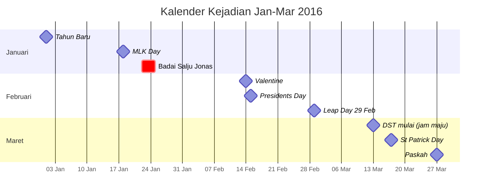
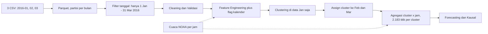
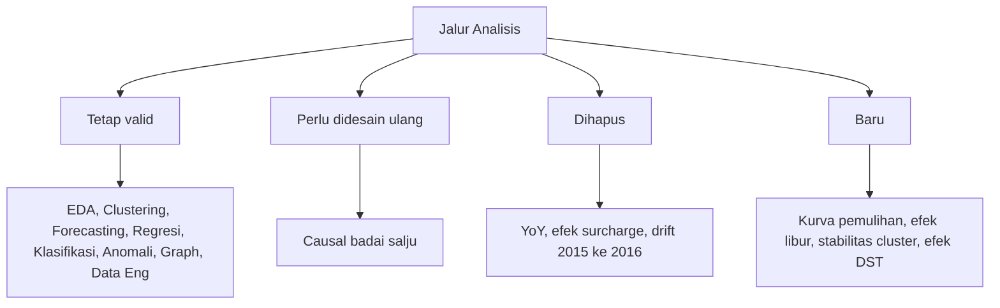
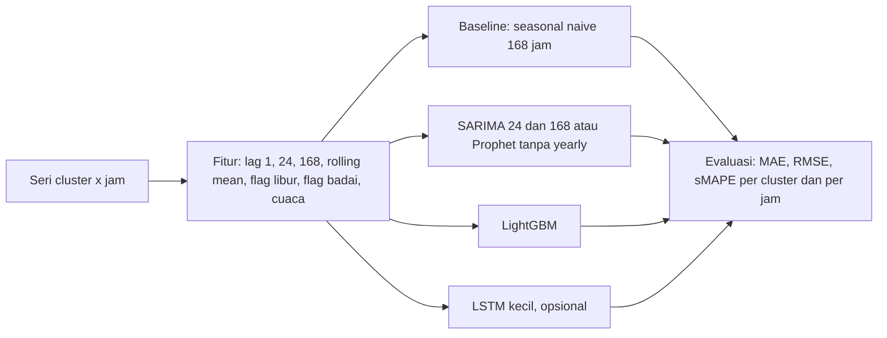
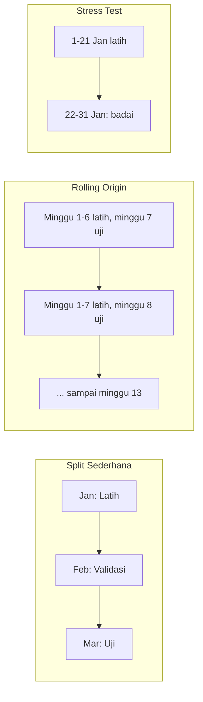

# 🎓 Revisi Framework: NYC Yellow Taxi, **Januari – Maret 2016**

Saya asumsikan kamu memakai **tiga bulan berurutan (Jan, Feb, Mar 2016) saja**, tanpa Jan 2015. Kalau asumsi itu keliru, bilang saja dan saya sesuaikan.

Perubahan ini memengaruhi desain, bukan cuma jumlah data. Beberapa ide saya sebelumnya jadi **tidak valid**, dan ada ide baru yang justru jadi lebih menarik.

---

## 1. Apa yang Berubah?

| Aspek | Sebelumnya (Jan 2015 + Jan–Mar 2016) | Sekarang (Jan–Mar 2016) | Dampak |
|---|---|---|---|
| Perbandingan antar tahun | Bisa untuk Januari | ❌ Tidak ada | Buang analisis YoY |
| Causal DiD badai salju | Kontrol: Jan 2015 | ❌ Tidak ada kontrol tahun lalu | **Desain kausal harus diganti** |
| Efek *improvement surcharge* | Bisa (mulai 2015) | ❌ Tarif sudah konstan | Buang topik ini |
| Concept drift 2015→2016 | Bisa diuji | ❌ | Ganti jadi *drift* Jan→Mar |
| Musiman tahunan | Sangat terbatas | ❌ Hanya 13 minggu | Jangan pakai yearly seasonality |
| Musiman harian dan mingguan | Ada | ✅ Ada, 13 siklus mingguan | Tetap valid |
| Volume data | ~±45 juta baris | ~±34 juta baris (sekitar 11 juta per bulan) | Tetap besar, pakai Parquet |
| Kontinuitas waktu | Ada celah | ✅ Kontinu 91 hari | **Lebih bersih untuk time series** |
| Konsistensi format | Dua tahun | Satu rezim data | Cleaning lebih sederhana |

> 💡 **Kabar baiknya:** data kontinu 91 hari tanpa celah itu ideal untuk time series. Kamu kehilangan perbandingan antar tahun, tapi mendapat dataset yang lebih rapi dan satu rezim aturan tarif.

---

## 2. Kalender 91 Hari: Ini Aset Terbesarmu

Karena rentangnya pendek, **setiap kejadian di kalender berpengaruh besar** dan harus dimodelkan secara eksplisit.



| Kejadian | Mengapa penting untuk analisis |
|---|---|
| **Badai Jonas (22–24 Jan)** | Guncangan eksogen ekstrem. Jadi pusat studi kausal dan *stress test* forecasting |
| **MLK Day & Presidents' Day** | Senin libur, jadi pola Senin berubah (*long weekend*) |
| **Leap Day (29 Feb, Senin)** | Hari tambahan, tidak ada padanannya di data lain |
| **DST 13 Maret** | Jam 02:00 melompat ke 03:00. Hari itu hanya punya **23 jam**, dan timestamp bisa menimbulkan *bug* agregasi per jam |
| **St. Patrick's Day** | Lonjakan permintaan malam hari di area tertentu |
| **Transisi musim** | Suhu naik dari Jan ke Mar, jadi permintaan dan perilaku tip bisa bergeser |

---

## 3. Pertanyaan Riset yang Cocok untuk 3 Bulan

Pilih **satu pertanyaan utama** dan jadikan sisanya pendukung.

1. **Prediksi:** Berapa pickup per zona dalam 1 jam ke depan, dan seberapa buruk model saat badai?
2. **Kausal:** Berapa permintaan taksi yang hilang karena Jonas, dan berapa lama pulihnya?
3. **Spasial:** Apakah zona permintaan (*cluster*) stabil dari Jan ke Mar, atau bergeser?
4. **Perilaku:** Apakah tip dan metode pembayaran berubah saat cuaca buruk atau hari libur?
5. **Operasional:** Di mana dan kapan sopir sebaiknya menunggu agar pendapatan per jam maksimal?

---

## 4. Pipeline yang Diperbarui



Perhatikan langkah **"Clustering di data Jan saja, lalu assign ke Feb dan Mar"**. Ini mencegah *leakage* dan sekaligus memberi bahan analisis stabilitas cluster.

---

## 5. Cleaning: Tambahan Aturan Khusus

Semua aturan cleaning sebelumnya tetap berlaku (koordinat, jarak, durasi, kecepatan, penumpang, tarif, rate code, konsistensi finansial). Tambahkan:

| Masalah | Aturan | Alasan |
|---|---|---|
| Timestamp nyasar | Pertahankan `pickup` hanya dalam 2016-01-01 s.d. 2016-03-31 | File bulanan sering memuat baris di luar bulannya |
| Hari DST (13 Mar) | Jangan *upsample* jam 02:00, tandai sebagai jam "tidak ada" | Jangan dianggap permintaan = 0 |
| Jam sepi saat badai | Jangan di-*impute* dan jangan dibuang | Permintaan rendah itu **sinyal**, bukan error |
| Duplikat | Cek baris identik penuh | Rekaman ganda dari vendor |
| Dropoff di luar rentang | Dropoff boleh lewat tengah malam 31 Mar | Jangan dibuang karena batas tanggal |

> ⚠️ **Jebakan klasik:** saat menjalankan filter kecepatan atau durasi, jangan sampai tanpa sengaja menghapus semua trip di jam badai. Hitung dulu persentase baris yang terbuang **per hari**. Kalau 22–24 Jan terpotong jauh lebih banyak dari hari lain, cleaning-mu bias.

---

## 6. Feature Engineering (Disesuaikan)

### 6.1 Waktu
- `pickup_hour`, `day_of_week`, `is_weekend`, `is_rush_hour`
- `day_index` (1–91) dan `week_index` (1–13)
- Flag libur: `is_new_year`, `is_mlk`, `is_presidents_day`, `is_stpatricks`, `is_easter_weekend`
- `is_long_weekend` (Sab–Senin libur)
- `is_dst_day`

### 6.2 Badai (fitur paling berharga di dataset ini)
- `is_storm_window` (22–24 Jan)
- `hours_since_storm_start` dan `days_since_storm_end` untuk memodelkan **kurva pemulihan**
- `snow_depth`, `snowfall` dari NOAA (opsional tapi sangat disarankan)

### 6.3 Yang harus hati-hati
- **Jangan** memasukkan `month` sebagai kategori mentah. Dengan hanya 3 nilai, ia akan menjadi *proxy* tren dan badai sekaligus. Pakai `day_index` yang halus atau suhu.
- Fitur spasial dan derivatif (haversine, Manhattan, bearing, `avg_speed`, `tip_pct` hanya untuk kartu kredit, `detour_ratio`) tidak berubah.

---

## 7. Status Setiap Jalur Analisis



### 🟢 Jalur A: EDA
Fokus perbandingan **antar bulan**, bukan antar tahun.
- Apakah rata-rata trip harian naik dari Jan → Feb → Mar?
- Heatmap jam × hari per bulan. Apakah puncak rush hour bergeser?
- Seberapa dalam "lembah" 22–24 Jan dibanding Sabtu dan Minggu biasa?

### 🟡 Jalur B: Clustering (dengan tambahan yang kuat)
Selain langkah sebelumnya (MiniBatchKMeans, HDBSCAN, H3, OD matrix), tambahkan **analisis stabilitas**:

| Langkah | Detail |
|---|---|
| Fit | Latih cluster pada **Jan** |
| Uji | Terapkan ke Feb dan Mar, bandingkan komposisi titik per cluster |
| Metrik | Pergeseran proporsi per cluster, silhouette di tiap bulan, ARI antara cluster yang dilatih ulang tiap bulan |
| Pertanyaan | Apakah hotspot bandara naik saat cuaca membaik? Apakah cluster Manhattan tengah menyusut saat badai? |

### 🟡 Jalur C: Forecasting Demand per Cluster
Perubahan penting dengan data hanya 13 minggu:

- **Matikan yearly seasonality** (di Prophet: `yearly_seasonality=False`).
- Pakai musiman **harian (24)** dan **mingguan (168)** saja. Lag maksimum yang masuk akal adalah **168 jam**.
- Setiap seri hanya punya sekitar **2.183 titik** (91 × 24, minus satu jam DST), jadi model deep learning besar rawan *overfit*. **Baseline kuat + GBM (LightGBM)** biasanya menang.
- Karena `lag_168` butuh 1 minggu sebagai pemanasan, minggu pertama tidak bisa dipakai sebagai target.



### 🟡 Jalur D: Regresi (Durasi, Tarif, Tip)
Tidak banyak berubah. Tambahan yang berguna:
- Uji apakah **koefisien jam sibuk berubah** dari Jan ke Mar.
- Bandingkan error model pada hari badai vs hari normal. Itu informasi tentang ketahanan model.
- Tip: fitur `suhu` dan `snowfall` bisa sangat informatif untuk perilaku pembayar kartu kredit.

### 🟠 Jalur E: Klasifikasi
Tidak berubah. Pastikan **time-based split**, dan tetap awas *leakage* `total_amount`.

### 🟠 Jalur F: Deteksi Anomali
Badai salju memberi kamu satu pelajaran penting: **anomali kontekstual**.
- Jumlah trip 23 Jan jam 14.00 yang sangat rendah bukan data error, tapi *anomali yang valid secara nyata*.
- Bandingkan dua detektor: (1) tanpa konteks (z-score global) dan (2) dengan konteks (residual dari model forecast). Detektor kedua seharusnya menangkap badai dan tidak salah menandai Minggu pagi sebagai anomali.

### 🔴 Jalur G: Causal Inference (Didesain Ulang)

Tanpa kontrol Jan 2015, **DiD klasik tidak tersedia**. Alternatifnya:

| Desain | Cara kerja | Kelebihan | Kelemahan |
|---|---|---|---|
| **Counterfactual forecast** | Latih model pada 1–21 Jan (tanpa badai), prediksi 22–31 Jan, selisih = efek badai | Intuitif, memakai Jalur C | Hanya 3 minggu latihan |
| **Interrupted Time Series** | Regresi segmen dengan kontrol hari-dalam-minggu dan libur | Standar, mudah ditafsirkan | Butuh asumsi tren stabil |
| **Event study** | Plot selisih actual vs prediksi per jam sebelum, saat, dan sesudah badai | Memperlihatkan kurva pemulihan | Tergantung kualitas model |
| **Variasi spasial** | Bandingkan penurunan di zona berbeda (Manhattan vs bandara vs outer borough) | Memberi *heterogeneous effect* | Bukan kausal murni |
| **Hari serupa sebagai kontrol** | Bandingkan Sabtu 23 Jan dengan rata-rata Sabtu lain | Sederhana | Satu hari, rentan *noise* |

Metrik hasil: total trip hilang, persentase penurunan puncak, **jam sampai pemulihan 90%** dari baseline.

> ⚠️ **Batas klaim:** satu badai, satu kota, 13 minggu. Kamu boleh bilang "badai berasosiasi dengan penurunan X% setelah mengontrol pola mingguan". Kamu belum boleh menggeneralisasi ke "badai salju selalu menurunkan permintaan X%".

### 🔴 Jalur H: Graph
Bangun graf OD **per bulan** (tiga graf), lalu bandingkan PageRank dan komunitas antar bulan. Tambahkan graf khusus 22–24 Jan untuk melihat jaringan yang "menyusut".

### 🔵 Jalur I: Rekomendasi Operasional
Hitung pendapatan per jam sopir per cluster × jam, dengan skenario **normal vs badai vs libur**. Insight bisnisnya adalah apakah aturan "tunggu di cluster Y" tetap benar saat kondisi ekstrem.

### 🔵 Jalur J: Data Engineering
Dengan hanya 3 file, kamu bisa membandingkan CSV → Parquet dengan benchmark Pandas vs Polars vs DuckDB secara bersih.

### 🆕 Jalur baru yang hanya cocok untuk 3 bulan
1. **Efek libur dan long weekend:** bandingkan Senin MLK dan Presidents' Day dengan Senin biasa.
2. **Efek DST:** apakah ada pergeseran puncak pagi di minggu setelah 13 Maret? Ini studi *natural experiment* kecil yang jarang dikerjakan orang.
3. **Pemanasan Jan → Mar:** bagaimana suhu memengaruhi trip pendek (jalan kaki jadi alternatif) dan tip?

---

## 8. Strategi Validasi (Ditulis Ulang)

Karena rentangnya pendek, jangan pakai satu split saja.



**Rekomendasi saya:**
1. **Rolling origin mingguan** sebagai evaluasi utama, sekitar 7 fold dengan jendela uji 12 Feb s.d. 31 Mar. Hasilnya lebih stabil daripada satu split.
2. **Split Jan/Feb/Mar** sebagai tampilan yang mudah dilaporkan.
3. **Stress test badai** sebagai eksperimen terpisah (sekaligus basis Jalur G).

**Catatan tentang badai di data latih:** karena badai ada di Januari, ia akan masuk data latih pada split sederhana. Ada tiga pilihan, dan kamu harus mendokumentasikan pilihanmu:
- Beri flag `is_storm_window` agar model belajar memisahkannya.
- Keluarkan 22–24 Jan dari latihan, lalu uji ketahanan model.
- Gunakan fitur cuaca asli (`snowfall`), yang lebih bersih secara metodologi.

---

## 9. Kerangka Kode (Disesuaikan)

```python
import polars as pl
from datetime import datetime

paths = [f"yellow_tripdata_2016-0{m}.parquet" for m in (1, 2, 3)]
df = pl.concat([pl.scan_parquet(p) for p in paths])

clean = (
    df.filter(
        pl.col("tpep_pickup_datetime").is_between(
            datetime(2016, 1, 1), datetime(2016, 3, 31, 23, 59, 59)
        )
        & pl.col("pickup_latitude").is_between(40.5, 40.95)
        & pl.col("pickup_longitude").is_between(-74.3, -73.65)
        & (pl.col("trip_distance") > 0) & (pl.col("trip_distance") < 100)
        & pl.col("passenger_count").is_between(1, 6)
        & (pl.col("fare_amount") > 0)
    )
    .with_columns(
        duration_min=(pl.col("tpep_dropoff_datetime")
                      - pl.col("tpep_pickup_datetime")).dt.total_seconds() / 60,
        hour=pl.col("tpep_pickup_datetime").dt.hour(),
        dow=pl.col("tpep_pickup_datetime").dt.weekday(),
        date=pl.col("tpep_pickup_datetime").dt.date(),
    )
    .filter(pl.col("duration_min").is_between(1, 180))
    .with_columns(avg_mph=pl.col("trip_distance") / (pl.col("duration_min") / 60))
    .filter(pl.col("avg_mph") < 80)
    .with_columns(
        is_storm=pl.col("date").is_between(datetime(2016, 1, 22).date(),
                                           datetime(2016, 1, 24).date())
    )
)

# Agregasi per cluster x jam (setelah kolom 'cluster' ditambahkan)
hourly = (
    clean.sort("tpep_pickup_datetime")
    .group_by_dynamic("tpep_pickup_datetime", every="1h", group_by="cluster")
    .agg(pl.len().alias("pickups"))
)
```

> Ingat: tabel agregasi ini **tidak otomatis memuat jam dengan 0 trip**. Untuk cluster sepi saat badai, jam kosong harus ditambahkan secara eksplisit (kecuali jam DST yang memang tidak ada).

---

## 10. Batasan yang Harus Kamu Tulis di Laporan

Bagian "Limitations" yang jujur sering membedakan nilai A dari B:

1. **Hanya 13 minggu:** tidak ada musiman tahunan, jadi jangan klaim "pola musiman".
2. **Satu badai:** efek kausal tidak bisa digeneralisasi.
3. **Tren jangka panjang tak teramati:** pertumbuhan ride-hailing tidak bisa dipisah dari tren Jan→Mar.
4. **Cash tip tidak tercatat:** analisis tip hanya untuk kartu kredit.
5. **`passenger_count` diisi manual** oleh sopir, jadi kualitasnya meragukan.
6. **Koordinat mentah (GPS taksi):** ada *noise*, dan tidak setara dengan zona resmi TLC.

---

## 11. Rencana Kerja 8 Minggu (Contoh)

| Minggu | Kegiatan | Output |
|---|---|---|
| 1 | Konversi Parquet, audit kualitas | Tabel *data attrition* |
| 2 | Cleaning dan EDA | 5 insight utama |
| 3 | Feature engineering, tambah cuaca dan kalender | Tabel analitik |
| 4 | Clustering (fit di Jan), uji stabilitas | Peta cluster |
| 5 | Agregasi cluster × jam, baseline | Seasonal naive |
| 6 | Model utama (LightGBM, SARIMA) dan rolling CV | Tabel perbandingan |
| 7 | Stress test badai, analisis kausal | Kurva pemulihan |
| 8 | Interpretasi (SHAP), laporan, presentasi | Notebook final |

---

## 12. Rekomendasi Paket Proyek

| Paket | Isi | Cocok untuk |
|---|---|---|
| **Paket Utama** ⭐ | Clustering (Jan) → forecasting per cluster → **kausal badai** | Skripsi atau proyek akhir, ceritanya utuh |
| **Paket Ringan** | EDA + prediksi durasi + efek libur | Tugas semester dengan waktu singkat |
| **Paket Perilaku** | Tip + metode pembayaran + cuaca + libur | Tertarik analisis perilaku konsumen |
| **Paket Engineering** | Pipeline Parquet/DuckDB + benchmark + dashboard | Jalur data engineer |

---

### ✅ Catatan dari saya

Dengan hanya tiga bulan, **kekuatan dataset ini bergeser**. Ia bukan lagi dataset untuk "membandingkan tahun", tetapi dataset untuk **kejadian ekstrem di dalam satu musim**: badai, libur, dan pergantian jam. Mahasiswa yang cerdas akan menjadikan badai Jonas sebagai pusat cerita, bukan sebagai noise yang dibersihkan.

Satu pertanyaan penentu: **tujuan akhirmu apa, tugas kuliah, skripsi, atau portofolio?** Dari situ saya bisa pilihkan satu paket dan buatkan skeleton notebook-nya langkah demi langkah.