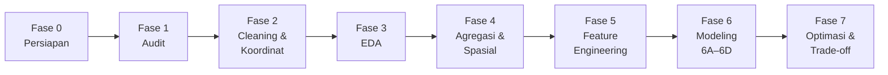

# 🚕 NYC Yellow Taxi Demand Analytics

### Analisis Spasial-Temporal & Forecasting Permintaan Taksi Kuning New York City

**Project Akhir Data Science · Januari – Juni 2026**

---

## 📌 Sekilas Proyek

|                            |                                                                                                  |
| :------------------------- | :----------------------------------------------------------------------------------------------- |
| 🎯 **Tujuan**              | Memahami pola pickup taksi kuning, menemukan hotspot, dan memodelkan permintaan per zona per jam |
| 📅 **Periode utama**       | Januari – Juni 2026 (6 file Parquet)                                                             |
| 📍 **Representasi lokasi** | **Longitude & latitude centroid zona** (menggantikan `PULocationID` / `DOLocationID`)            |
| 🧮 **Unit analisis**       | Zona pickup (pasangan `PU_longitude`, `PU_latitude`) × 1 jam                                     |
| 🎲 **Target**              | Jumlah pickup 1 jam ke depan _(24 jam = pengembangan opsional)_                                  |
| 🤖 **Model**               | Regression · SVM Classification · Time Series, dibandingkan dengan baseline _Seasonal Naive_     |
| ✂️ **Pembagian data**      | Train Jan–Apr · Validation Mei · Test Juni                                                       |
| 🏁 **Batas brief**         | Berakhir di **Optimasi & Trade-off analysis**                                                    |

> [!NOTE]
> Jumlah pickup adalah **_served demand_**, yaitu perjalanan yang berhasil dilayani, bukan seluruh permintaan taksi yang sebenarnya.

**Isi dokumen**

1. Pertanyaan Penelitian
2. Pemetaan Materi Kuliah ke Modeling
3. Dataset
4. Struktur Folder
5. Alur Pengerjaan
6. Tahapan Detail (Fase 0 – 7)
7. Aturan Emas & Risiko
8. Keputusan & Checklist
9. Referensi

---

## ❓ 1. Pertanyaan Penelitian

|  Kode   | Pertanyaan                                                                                           | Dijawab di                      |
| :-----: | :--------------------------------------------------------------------------------------------------- | :------------------------------ |
| **RQ1** | Bagaimana pola pickup berdasarkan jam, hari, dan bulan?                                              | Fase 3 (EDA)                    |
| **RQ2** | Zona mana yang menjadi hotspot / cold spot, dan apakah stabil antarbulan?                            | Fase 4 (Spasial)                |
| **RQ3** | Seberapa akurat model memprediksi pickup per zona per jam, dan model mana yang paling layak dipilih? | Fase 6 – 7 (Modeling, Optimasi) |
| **RQ4** | Zona dan waktu mana yang layak diprioritaskan berdasarkan volume pickup?                             | Fase 3, 4, dan 7                |

---

## 🎓 2. Pemetaan Materi Kuliah ke Modeling

| Pertemuan | Materi                        | Dipakai di proyek sebagai                                                                 | Fase  |
| :-------: | :---------------------------- | :---------------------------------------------------------------------------------------- | :---: |
|  **P9**   | Supervised Learning           | Kerangka umum: fitur (X), target (y), split kronologis, baseline, evaluasi, _overfitting_ | 5, 6A |
|  **P10**  | SVM (Classification)          | Mengklasifikasikan zona-jam ke level permintaan **Rendah / Sedang / Tinggi**              |  6C   |
|  **P11**  | Regression                    | Memprediksi **jumlah pickup** per zona per jam (Linear, Ridge, Lasso)                     |  6B   |
|  **P12**  | Time Series Analysis          | Dekomposisi, uji stasioneritas, ACF/PACF, SARIMA / Holt-Winters pada deret pickup         |  6D   |
|  **P13**  | Optimasi & Trade-off analysis | _Hyperparameter tuning_, perbandingan model, trade-off akurasi vs kompleksitas vs waktu   |   7   |

> [!NOTE]
> Daftar materi P12 pada halaman kuliah belum terlihat isinya, jadi isi Fase 6D mengikuti topik umum _time series_. Sesuaikan dengan materi dosen setelah tersedia. Tugas P11 (Regression) baru dibuka **5 November 2026**.

---

## 🗃️ 3. Dataset

### 3.1 Sumber & Cakupan

Data berasal dari **NYC Taxi & Limousine Commission (TLC)**, khusus **Yellow Taxi** (_Yellow Medallion Taxicabs_, taksi yang boleh menerima cegatan langsung di jalan).

| Periode            | Format lokasi                                            | Peran dalam proyek                                  |
| :----------------- | :------------------------------------------------------- | :-------------------------------------------------- |
| **Jan – Jun 2026** | Indeks zona, lalu diganti koordinat centroid (lihat 3.5) | ⭐ **Data utama**                                   |
| **Jan – Mar 2016** | Koordinat `latitude` / `longitude` presisi               | Pembanding / eksperimen berbasis titik _(opsional)_ |

> [!WARNING]
> Data 2016 dan 2026 **tidak membentuk deret waktu yang kontinu** dan skemanya berbeda. Jangan digabung dalam satu model _time series_. Periksa kesesuaian kolom sebelum membandingkan keduanya.

### 3.2 Skema Kolom (Data Asli 2026)

<details open>
<summary><b>⏱️ Waktu & Lokasi</b></summary>

| Kolom                   | Tipe           | Keterangan                                                        |
| :---------------------- | :------------- | :---------------------------------------------------------------- |
| `tpep_pickup_datetime`  | datetime64[us] | Waktu argometer dinyalakan (pickup), **waktu lokal New York**     |
| `tpep_dropoff_datetime` | datetime64[us] | Waktu argometer dimatikan                                         |
| `PULocationID`          | int32          | Zona TLC tempat penjemputan _(diganti koordinat di `main_trips`)_ |
| `DOLocationID`          | int32          | Zona TLC tempat penurunan _(diganti koordinat di `main_trips`)_   |

</details>

<details open>
<summary><b>🚖 Atribut Perjalanan</b></summary>

| Kolom                | Tipe    | Keterangan                                                              |
| :------------------- | :------ | :---------------------------------------------------------------------- |
| `VendorID`           | int32   | Penyedia teknologi TPEP (lihat 3.3)                                     |
| `passenger_count`    | float64 | Jumlah penumpang (diinput pengemudi)                                    |
| `trip_distance`      | float64 | Jarak tempuh dalam **mil** menurut argometer                            |
| `RatecodeID`         | float64 | Kode tarif akhir (lihat 3.3)                                            |
| `store_and_fwd_flag` | str     | `Y` = disimpan di kendaraan dulu karena koneksi bermasalah, `N` = tidak |
| `payment_type`       | int64   | Metode pembayaran (lihat 3.3)                                           |

</details>

<details open>
<summary><b>💵 Komponen Biaya</b></summary>

| Kolom                   | Tipe    | Keterangan                                                                      |
| :---------------------- | :------ | :------------------------------------------------------------------------------ |
| `fare_amount`           | float64 | Tarif dasar dari waktu + jarak                                                  |
| `extra`                 | float64 | Surcharge: **$0.50** jam sibuk (16.00–20.00) atau **$1.00** malam (20.00–06.00) |
| `mta_tax`               | float64 | Pajak MTA **$0.50**                                                             |
| `improvement_surcharge` | float64 | **$0.30** saat argometer dinyalakan                                             |
| `tip_amount`            | float64 | Tip **kartu kredit saja**; tip tunai tidak tercatat                             |
| `tolls_amount`          | float64 | Total biaya tol selama perjalanan                                               |
| `congestion_surcharge`  | float64 | Biaya kemacetan NYS                                                             |
| `Airport_fee`           | float64 | Biaya penjemputan di **LGA** dan **JFK**                                        |
| `cbd_congestion_fee`    | float64 | Biaya _MTA Congestion Relief Zone_ (CBD), berlaku sejak **5 Jan 2025**          |
| `total_amount`          | float64 | Total tagihan ke penumpang (tanpa tip tunai)                                    |

</details>

### 3.3 Kode Referensi

<table>
<tr>
<td valign="top">

**`VendorID`**

| Kode | Vendor                       |
| :--: | :--------------------------- |
|  1   | Creative Mobile Technologies |
|  2   | Curb Mobility                |
|  6   | Myle Technologies            |
|  7   | Helix                        |

</td>
<td valign="top">

**`RatecodeID`**

| Kode | Arti                 |
| :--: | :------------------- |
|  1   | Standard rate        |
|  2   | JFK                  |
|  3   | Newark               |
|  4   | Nassau / Westchester |
|  5   | Negotiated fare      |
|  6   | Group ride           |
|  99  | Null / Unknown       |

</td>
<td valign="top">

**`payment_type`**

| Kode | Arti           |
| :--: | :------------- |
|  0   | Flex Fare trip |
|  1   | Credit card    |
|  2   | Cash           |
|  3   | No charge      |
|  4   | Dispute        |
|  5   | Unknown        |
|  6   | Voided trip    |

</td>
</tr>
</table>

### 3.4 Contoh Fare Perjalanan Reguler (`RatecodeID = 1`)

| Jenis              | Komponen                                                          | Kapan berlaku                                           |
| :----------------- | :---------------------------------------------------------------- | :------------------------------------------------------ |
| ✅ **Selalu**      | `fare_amount`, `mta_tax` ($0.50), `improvement_surcharge` ($0.30) | Setiap transaksi reguler                                |
| 🔸 **Kondisional** | `extra`                                                           | Jam sibuk sore atau malam hari                          |
| 🔸 **Kondisional** | `congestion_surcharge`, `cbd_congestion_fee`                      | Rute di kawasan CBD Manhattan                           |
| 🔸 **Kondisional** | `tolls_amount`                                                    | Melewati jalan tol, jembatan, atau terowongan berbayar  |
| 🔸 **Kondisional** | `tip_amount`                                                      | Bayar kartu kredit (`payment_type = 1`) dan memberi tip |

$$
\text{total\_amount} = \text{fare\_amount} + \text{mta\_tax} + \text{improvement\_surcharge} + \text{extra} + \text{surcharge/tolls} + \text{tip\_amount}
$$

> [!TIP]
> Rumus di atas versi sederhana. Pada data nyata, `total_amount` juga memuat `congestion_surcharge`, `Airport_fee`, dan `cbd_congestion_fee` bila berlaku.

### 3.5 Mengganti ID Lokasi dengan Longitude & Latitude

Dataset 2026 tidak punya titik GPS, sehingga koordinat diambil dari **centroid zona TLC**. Di `main_trips`, kolom ID lokasi **digantikan** oleh empat kolom koordinat.

| Kolom ID (dilepas) | Diganti dengan                | Keterangan            |
| :----------------- | :---------------------------- | :-------------------- |
| `PULocationID`     | `PU_longitude`, `PU_latitude` | Centroid zona pickup  |
| `DOLocationID`     | `DO_longitude`, `DO_latitude` | Centroid zona dropoff |

**Aturan penggantian**

1. Gunakan **Taxi Zone Lookup / Shapefile TLC** sebagai sumber geometri, simpan di `datasets/zone/`.
2. Ambil centroid tiap zona dalam **WGS84 (EPSG:4326)**. Hitung **sekali** ke dalam satu tabel centroid, jangan dihitung ulang per file.
3. Join lewat `PULocationID` dan `DOLocationID` dengan **_left join_** agar baris perjalanan tidak hilang.
4. Pastikan join **tidak menggandakan baris** dan satu zona hanya punya satu pasangan koordinat.
5. Pastikan **tiap zona punya pasangan koordinat unik**, karena pasangan ini kini menjadi pengenal zona saat agregasi dan pembuatan lag.
6. **Turunkan atribut zona dulu sebelum ID dilepas**: `borough`, `zone_name`, `is_airport`, `is_cbd`. Atribut ini tidak bisa dibuat lagi dari koordinat dengan mudah.
7. Hapus kolom ID **hanya di `datasets/interim/`**. File di `datasets/raw/` tetap utuh dengan ID aslinya.

> [!IMPORTANT]
> **Simpan tabel pemetaan** (`LocationID`, `longitude`, `latitude`, `zone_name`, `borough`) di `datasets/zone/`, misalnya sebagai `zone_centroid_lookup.csv`. Tanpa tabel ini, koordinat tidak bisa dikembalikan ke zona/poligon untuk pemetaan dan uji spasial.

> [!WARNING]
> Beberapa hal yang perlu dicek setelah ID diganti:
>
> - **Koordinat bukan GPS asli** penjemputan/penurunan. Gunakan sebagai representasi lokasi zona.
> - Zona berstatus _Unknown_ (umumnya ID 264 dan 265) biasanya **tidak punya geometri**, sehingga koordinatnya kosong. Putuskan dibuang atau dilabeli khusus, lalu catat di tabel _attrition_.
> - **Moran's I dan Getis-Ord Gi\*** tetap bisa dijalankan: pakai poligon (lewat tabel pemetaan) atau bangun _spatial weights_ dari titik centroid (_k-nearest neighbors_ / _distance band_). Catat pilihan yang dipakai.

### 3.6 Dataset Turunan

Cukup satu dataset utama yang dibersihkan, lalu buat turunan sesuai kebutuhan analisis.

| Dataset                         | Isi                                                                                                       | Kegunaan                           | Simpan di                |
| :------------------------------ | :-------------------------------------------------------------------------------------------------------- | :--------------------------------- | :----------------------- |
| `main_trips`                    | Perjalanan per baris + koordinat centroid, atribut zona, waktu, atribut transaksi (tanpa kolom ID lokasi) | Sumber utama semua analisis        | `datasets/interim/2026/` |
| `demand_zone_hour`              | Jumlah pickup per pasangan `PU_longitude`/`PU_latitude` per jam                                           | EDA temporal, hotspot, semua model | `datasets/interim/2026/` |
| `revenue_analysis` _(opsional)_ | Agregasi dengan atribut tarif yang sudah divalidasi                                                       | Indeks potensi pendapatan          | `datasets/interim/2026/` |

**Mengapa dipisah?** Aturan validitas demand dan pendapatan berbeda. Untuk demand, yang penting waktu dan lokasi pickup valid. Baris dengan tarif/jarak bermasalah belum tentu dibuang dari analisis demand. Sebaliknya, analisis pendapatan membutuhkan nilai transaksi yang layak.

### 3.7 Kalender Libur & Event 2026 (Jan – Jun)

Dipakai untuk fitur `is_holiday` dan penjelasan lonjakan/penurunan pickup. Tabel lengkap beserta padanan 2016 ada di `FederalHolidays_Event.md`.

| Tanggal                | Hari / Event                          | Kategori        | Periode data |
| :--------------------- | :------------------------------------ | :-------------- | :----------: |
| `2026-01-01`           | New Year's Day 🎆                     | Federal Holiday |    Train     |
| `2026-01-19`           | Martin Luther King Jr. Day            | Federal Holiday |    Train     |
| `2026-02-14`           | Valentine's Day 💖                    | Observance      |    Train     |
| `2026-02-16`           | Presidents' Day                       | Federal Holiday |    Train     |
| `2026-03-17`           | St. Patrick's Day ☘️ (parade 5th Ave) | Major NYC Event |    Train     |
| `2026-04-05`           | Easter Sunday 🐣                      | Religious       |    Train     |
| `2026-04-15` – `04-26` | Tribeca Film Festival 🎬              | Major NYC Event |    Train     |
| `2026-05-10`           | Mother's Day 💐                       | Observance      |  Validation  |
| `2026-05-20` – `05-26` | Fleet Week NYC 🚢                     | Major NYC Event |  Validation  |
| `2026-05-25`           | Memorial Day 🎖️                       | Federal Holiday |  Validation  |
| `2026-06-19`           | Juneteenth 🕊️                         | Federal Holiday |     Test     |
| `2026-06-21`           | Father's Day 👔                       | Observance      |     Test     |
| `2026-06-28`           | NYC Pride March 🌈                    | Major NYC Event |     Test     |

> [!NOTE]
> Libur federal ada di setiap bagian data (Train, Validation, Test), sehingga model bisa dievaluasi pada hari libur yang belum pernah dilihat saat training.

---

## 📁 4. Struktur Folder

```text
projectAkhir_DS/
├── .vscode/                 # Konfigurasi VS Code
├── archive/                 # Arsip dan file sekali pakai
├── datasets/
│   ├── datasets_docs/       # Dokumentasi, peta, dan PDF dataset
│   ├── external/            # Data referensi eksternal
│   ├── interim/             # Data hasil cleaning dan transformasi
│   ├── raw/                 # Data sumber asli
│   │   ├── 2016/
│   │   └── 2026/
│   │       └── withZone/    # Data 2026 yang telah dilengkapi informasi zona
│   └── zone/                # Shapefile dan lookup Taxi Zone
├── docs/                    # Catatan dan dokumentasi penelitian
├── out/
│   ├── html/                # Peta interaktif
│   └── output_eda/          # Grafik dan tabel hasil EDA
├── script/
│   ├── scratch/             # Eksperimen sementara
│   └── tools/               # Notebook dan utilitas pendukung
├── .gitignore
└── README.md
```

### Aturan Penyimpanan

| Jenis file                                     | Lokasi               |                 Boleh diubah?                 |
| :--------------------------------------------- | :------------------- | :-------------------------------------------: |
| Data sumber asli (masih ber-ID)                | `datasets/raw/`      |                 ❌ **Tidak**                  |
| Hasil cleaning, ganti ID → koordinat, agregasi | `datasets/interim/`  |                      ✅                       |
| Taxi Zone Lookup, Shapefile, tabel centroid    | `datasets/zone/`     | ❌ (sumber), ✅ (tabel centroid hasil olahan) |
| Kalender libur, data referensi lain            | `datasets/external/` |                      ✅                       |
| Grafik, tabel, peta, hasil model               | `out/`               |                      ✅                       |
| Notebook analisis (bernomor)                   | `script/`            |                      ✅                       |
| Analysis plan & catatan keputusan              | `docs/`              |                      ✅                       |

> [!IMPORTANT]
> Folder `withZone/` berisi data hasil join, jadi untuk konsistensi sebaiknya **dipindahkan ke `datasets/interim/2026/`**.

### Penempatan Output per Fase

| Fase | Notebook (saran nama)                       | Output utama                            | Lokasi output                               |
| :--: | :------------------------------------------ | :-------------------------------------- | :------------------------------------------ |
|  0   | –                                           | `analysis_plan.md`                      | `docs/`                                     |
|  1   | `script/01_audit.ipynb`                     | Tabel audit                             | `out/output_eda/`                           |
|  2   | `script/02_cleaning_join_coordinates.ipynb` | `main_trips`, tabel _attrition_         | `datasets/interim/2026/`, `out/output_eda/` |
|  3   | `script/03_eda.ipynb`                       | Grafik, peta, tabel EDA                 | `out/output_eda/`, `out/html/`              |
|  4   | `script/04_spatial_analysis.ipynb`          | `demand_zone_hour`, peta hotspot        | `datasets/interim/2026/`, `out/html/`       |
|  5   | `script/05_features.ipynb`                  | Dataset fitur + target                  | `datasets/interim/2026/`                    |
|  6B  | `script/06_regression.ipynb`                | Model & metrik regresi                  | `out/`                                      |
|  6C  | `script/07_svm_classification.ipynb`        | Model & metrik klasifikasi              | `out/`                                      |
|  6D  | `script/08_time_series.ipynb`               | Model & metrik time series              | `out/`                                      |
|  7   | `script/09_optimization_tradeoff.ipynb`     | Tuning, tabel trade-off, model terpilih | `out/`                                      |

### Setup Environment

```powershell
# Buat dan aktifkan virtual environment
py -m venv .venv
.\.venv\Scripts\Activate.ps1

# Install library
python -m pip install --upgrade pip
python -m pip install pandas numpy scipy matplotlib seaborn pyarrow jupyter
```

| Library | Versi  |
| :------ | :----- |
| Python  | 3.14.7 |
| pandas  | 3.0.6  |
| numpy   | 2.5.3  |
| scipy   | 1.18.1 |
| seaborn | 0.13.2 |

Library tambahan menyesuaikan kebutuhan notebook, misalnya `scikit-learn` (regresi, SVM, tuning), `statsmodels` (time series), serta `geopandas` dan `libpysal`/`esda` (analisis spasial). Pilih `.venv` sebagai kernel di VS Code dan catat versinya agar notebook bisa dijalankan ulang.

Dataset diunduh dari **Google Drive proyek**. Ekstrak ZIP lalu letakkan Yellow Taxi 2026 di `datasets/raw/`, atau jika memakai `datasets.zip`, paste di root untuk menggantikan folder `datasets`.

---

## 🔄 5. Alur Pengerjaan



| Fase | Fokus                           | Hasil akhir                         | Menjawab |
| :--: | :------------------------------ | :---------------------------------- | :------: |
|  0   | Persiapan                       | `analysis_plan.md`                  |    –     |
|  1   | Audit                           | Tabel audit                         |    –     |
|  2   | Cleaning + ganti ID → koordinat | `main_trips`                        |    –     |
|  3   | EDA                             | Grafik & peta                       | RQ1, RQ4 |
|  4   | Agregasi + spasial              | `demand_zone_hour`, hotspot         | RQ2, RQ4 |
|  5   | Feature engineering             | Dataset fitur                       |    –     |
|  6   | Modeling (P9 – P12)             | Model & metrik                      |   RQ3    |
|  7   | Optimasi & trade-off (P13)      | Model terpilih + analisis trade-off | RQ3, RQ4 |

---

## 🧭 6. Tahapan Detail

> Setiap fase punya **gate**: syarat yang harus terpenuhi sebelum lanjut ke fase berikutnya.

### 🔹 Fase 0 · Persiapan & Analysis Plan

**Tujuan:** memastikan tujuan, data, dan keputusan penelitian jelas sebelum pengolahan dimulai.

1. Tetapkan RQ dan target penelitian.
2. Tetapkan periode Januari – Juni 2026.
3. Tentukan aturan cleaning dan cara mengganti ID lokasi dengan koordinat.
4. Tetapkan metode hotspot dan skema pembagian data.
5. Catat semua keputusan, termasuk seed, periode, dan aturan cleaning, di `docs/analysis_plan.md`.

📦 **Output:** `docs/analysis_plan.md`
🚦 **Gate:** target, periode, aturan koordinat, dan skema evaluasi sudah ditentukan.

---

### 🔹 Fase 1 · Audit Dataset

**Tujuan:** memahami kondisi enam file Parquet sebelum dibersihkan.

1. Periksa nama kolom dan tipe data.
2. Hitung jumlah baris tiap bulan.
3. Periksa rentang waktu pickup dan dropoff.
4. Periksa _missing values_ dan duplikasi.
5. Periksa nilai tidak wajar pada waktu, lokasi, jarak, dan tarif.
6. Pastikan kolom `request_source` ada atau tidak di file yang dipakai, lalu sesuaikan data dictionary dengan skema asli.

📦 **Output:** tabel audit (jumlah baris, tipe data, missing, duplikasi, anomali).
🚦 **Gate:** skema keenam file dipahami dan perbedaan kolom antarbulan sudah dicatat.

---

### 🔹 Fase 2 · Cleaning & Penggantian ID dengan Koordinat

**Tujuan:** menghasilkan dataset perjalanan yang konsisten dengan lokasi berbasis koordinat.

**A. Cleaning**

1. Periksa waktu pickup dan dropoff.
2. Periksa ID zona pickup dan dropoff (nilai di luar daftar zona, termasuk zona _Unknown_).
3. Periksa duplikasi perjalanan.
4. Periksa anomali jarak, durasi, tarif, dan jumlah penumpang.
5. Tentukan penghapusan **berdasarkan kebutuhan analisis**, bukan otomatis membuang semua baris yang atribut pendukungnya anomali.
6. Catat jumlah baris sebelum dan sesudah tiap aturan dalam tabel **_attrition_**.

**B. Ganti ID dengan koordinat**

1. Siapkan tabel zona: `LocationID`, longitude & latitude centroid, `zone_name`, `borough`. Simpan ke `datasets/zone/`.
2. Turunkan atribut zona: `borough`, `is_airport`, `is_cbd`.
3. Join ke `PULocationID` untuk `PU_longitude` / `PU_latitude`, dan ke `DOLocationID` untuk `DO_longitude` / `DO_latitude`.
4. Periksa hasil join: jumlah baris tidak bertambah, koordinat kosong sudah ditangani, koordinat masuk akal (berada di wilayah NYC).
5. Periksa tiap zona punya pasangan koordinat yang unik.
6. Lepas `PULocationID` dan `DOLocationID` dari `main_trips`. File raw tidak disentuh.

📦 **Output:** `main_trips`, tabel _attrition_, tabel centroid.
🚦 **Gate:** jumlah baris setelah join konsisten, koordinat unik per zona, kegagalan join sudah dicatat, tabel pemetaan tersimpan.

---

### 🔹 Fase 3 · Exploratory Data Analysis (EDA)

**Tujuan:** memahami pola umum sebelum analisis spasial dan modeling.

1. Pickup berdasarkan jam, hari, dan bulan.
2. Perbandingan hari kerja, akhir pekan, dan hari libur (lihat 3.7).
3. Zona dengan pickup terbanyak dan konsentrasi Top-K.
4. Distribusi pickup per borough.
5. Peta persebaran pickup berdasarkan centroid zona.
6. Pola asal-tujuan memakai koordinat pickup dan dropoff.
7. Analisis `cbd_congestion_fee` secara **deskriptif**, bukan untuk menyimpulkan dampak kausal kebijakan.
8. Cek distribusi target (jumlah pickup): proporsi nilai nol, kemiringan distribusi, dan _outlier_. Ini menentukan pilihan transformasi dan metrik di Fase 6.

> [!NOTE]
> Periksa kembali hasil uji statistik dan angka ringkasan EDA UTS sebelum dipakai sebagai kesimpulan final.

📦 **Output:** grafik, peta, tabel ringkasan, temuan EDA.
🚦 **Gate:** setiap visual punya penjelasan dan menjawab salah satu RQ.

---

### 🔹 Fase 4 · Agregasi & Analisis Spasial

**Tujuan:** membentuk data zona-jam dan menemukan area dengan konsentrasi pickup tinggi atau rendah.

1. Bulatkan `tpep_pickup_datetime` ke interval satu jam.
2. Kelompokkan berdasarkan pasangan `PU_longitude`/`PU_latitude` dan jam.
3. Hitung jumlah pickup tiap kombinasi zona-jam.
4. Buat **grid zona-jam lengkap**. Kombinasi tanpa pickup pada jam valid diisi **nol**.
5. Tandai jam yang tidak ada karena DST sebagai **tidak tersedia, bukan nol**. DST dimulai **8 Maret 2026**.
6. Hubungkan hasil dengan nama zona, borough, dan geometri lewat tabel pemetaan.
7. Tentukan _spatial weights_ (poligon _contiguity_ atau titik centroid dengan KNN / distance band). Catat metode dan penanganan zona tanpa tetangga.
8. Hitung **Global Moran's I** (autokorelasi spasial) dan **Getis-Ord Gi\*** (hotspot/cold spot).
9. Terapkan koreksi uji berganda, misalnya **FDR**, pada hasil uji lokal.
10. Bandingkan hotspot antarbulan dengan **Jaccard Index**.

📦 **Output:** `demand_zone_hour`, peta hotspot/cold spot, hasil Moran's I dan Gi\*, tabel stabilitas bulanan.
🚦 **Gate:** total pickup agregat sama dengan jumlah pickup valid pada data sumber; grid waktu dan hasil uji spasial sudah diperiksa.

---

### 🔹 Fase 5 · Feature Engineering & Persiapan Supervised Learning _(P9)_

**Tujuan:** menyusun masalah sebagai _supervised learning_: tiap baris = satu zona pada satu jam, fitur (X) dari masa lalu, target (y) di masa depan.

**Fitur**

| Kelompok              | Contoh fitur                                               |
| :-------------------- | :--------------------------------------------------------- |
| ⏰ Waktu              | `hour`, `day_of_week`, `month`, `is_weekend`, `is_holiday` |
| 📈 Historis           | `lag_1`, `lag_24`, `lag_168` (dihitung per zona)           |
| 📊 Ringkasan historis | Rolling mean 24 jam & 168 jam (sudah di-_shift_)           |
| 🗺️ Lokasi             | `PU_longitude`, `PU_latitude`                              |
| 🏙️ Atribut zona       | `borough`, `is_airport`, `is_cbd` (diturunkan di Fase 2)   |

**Target**

| Model                    | Target (y)                                                |
| :----------------------- | :-------------------------------------------------------- |
| Regression (P11)         | `pickup_count` pada jam t+1                               |
| SVM Classification (P10) | `demand_level` pada jam t+1: **Rendah / Sedang / Tinggi** |
| Time Series (P12)        | Deret `pickup_count` (kota keseluruhan dan Top-K zona)    |

**Definisi `demand_level`:** tentukan batas kelas (misalnya persentil 33 dan 66 atau 25/75) **hanya dari data training**, lalu terapkan batas yang sama ke validation dan test. Alternatif: bandingkan pickup dengan rata-rata historis zona itu sendiri, agar kelas mencerminkan lonjakan waktu, bukan sekadar zona yang memang ramai.

**Aturan fitur**

- `lag_168` = pickup pada jam yang sama minggu lalu, sekaligus dasar baseline.
- Rolling mean hanya memakai data **sebelum** waktu prediksi.
- Koordinat **dropoff tidak dipakai**, karena tujuan perjalanan belum diketahui saat armada menunggu penumpang.
- Jangan pakai nilai transaksi yang baru diketahui setelah perjalanan (`total_amount`, `fare_amount`, `tip_amount`, `cbd_congestion_fee`).
- Skala fitur numerik (standardisasi) untuk Ridge/Lasso dan SVM. _Scaler_ di-_fit_ **hanya pada data training**.

**Pembagian data (kronologis)**

| Bagian            | Periode              | Fungsi                             |
| :---------------- | :------------------- | :--------------------------------- |
| 🟦 **Training**   | Januari – April 2026 | Melatih model                      |
| 🟨 **Validation** | Mei 2026             | Memilih fitur dan hyperparameter   |
| 🟥 **Testing**    | Juni 2026            | Evaluasi akhir, **dipakai sekali** |

📦 **Output:** dataset fitur dan target (regresi & klasifikasi) yang mengikuti urutan waktu, serta deret waktu untuk Fase 6D.
🚦 **Gate:** setiap fitur tersedia pada waktu prediksi, tidak ada _data leakage_, split kronologis benar, batas kelas hanya dari data training.

---

### 🔹 Fase 6 · Modeling

**Tujuan:** membangun model dari materi P9 – P12 dan membandingkannya dengan baseline pada periode yang sama.

#### 6A · Baseline _(P9 Supervised Learning)_

| Baseline                                                       | Dipakai untuk           |
| :------------------------------------------------------------- | :---------------------- |
| **Seasonal Naive (lag 168)**: pickup jam yang sama minggu lalu | Regresi dan time series |
| **Kelas mayoritas / kelas berdasarkan lag 168**                | Klasifikasi             |

Semua model wajib dibandingkan dengan baseline. Amati juga selisih performa train vs validation untuk mendeteksi _overfitting_ atau _underfitting_.

#### 6B · Regression _(P11)_: prediksi jumlah pickup

| Model                                      | Catatan                                                                                                |
| :----------------------------------------- | :----------------------------------------------------------------------------------------------------- |
| **Linear Regression**                      | Model dasar yang mudah diinterpretasi                                                                  |
| **Ridge**                                  | Regularisasi L2, menstabilkan koefisien saat fitur lag berkorelasi                                     |
| **Lasso**                                  | Regularisasi L1, ikut menyeleksi fitur                                                                 |
| Polynomial / model non-linear _(opsional)_ | Bila pola non-linear terlihat jelas; LightGBM bisa menjadi pembanding tambahan bila waktu memungkinkan |

**Metrik:** MAE, RMSE, **R²**, WAPE, dan MASE (terhadap seasonal naive).

> [!TIP]
> Jika distribusi pickup sangat miring dan banyak nol (cek di Fase 3), coba transformasi `log1p` pada target, tetapi **hitung metrik pada skala asli**. Hindari **MAPE** sebagai metrik utama karena banyak nilai aktual bernilai nol. Periksa juga asumsi regresi (residual, multikolinearitas fitur lag).

#### 6C · SVM Classification _(P10)_: level permintaan

| Model                                       | Catatan                                         |
| :------------------------------------------ | :---------------------------------------------- |
| **SVM kernel linear** (`LinearSVC` / `SVC`) | Cepat, cocok untuk data besar                   |
| **SVM kernel RBF**                          | Menangkap pola non-linear; atur `C` dan `gamma` |

**Metrik:** accuracy, precision, recall, **F1 (macro)**, dan _confusion matrix_. Bila kelas tidak seimbang, gunakan `class_weight="balanced"` dan jadikan macro-F1 sebagai metrik utama.

> [!WARNING]
> **Skala komputasi:** data zona-jam bisa mencapai jutaan baris, sedangkan SVM kernel RBF melambat tajam seiring jumlah data. Gunakan **sampel yang tetap menjaga urutan waktu** (misalnya sampel acak dari periode training saja), batasi ke Top-K zona, atau pakai kernel linear. Catat ukuran sampel dan alasannya di laporan.

#### 6D · Time Series Analysis _(P12)_: deret pickup

Karena ratusan zona terlalu banyak untuk dimodelkan satu per satu, modelkan **deret kota keseluruhan** dan **Top-K zona** (misalnya K = 5).

| Langkah          | Isi                                                                                           |
| :--------------- | :-------------------------------------------------------------------------------------------- |
| 1. Eksplorasi    | Plot deret, dekomposisi (**STL**) untuk tren dan musiman harian (24 jam) / mingguan (168 jam) |
| 2. Stasioneritas | Uji **ADF**, lakukan _differencing_ bila perlu                                                |
| 3. Identifikasi  | **ACF / PACF** untuk memilih orde                                                             |
| 4. Model         | **Holt-Winters (ETS)** dan **SARIMA**                                                         |
| 5. Evaluasi      | Prediksi pada Mei (validation) dan Juni (test), bandingkan dengan seasonal naive              |

> [!TIP]
> Periode musiman 168 membuat SARIMA per jam sangat berat. Gunakan periode **24** pada deret per jam, atau agregasi ke **harian** dengan periode **7**. Catat pilihan yang dipakai.

**Metrik:** MAE, RMSE, WAPE, MASE. Periksa residual (tidak berpola, mendekati _white noise_).

📦 **Output Fase 6:** model terlatih, hasil prediksi, tabel metrik per model, grafik aktual vs prediksi, analisis kesalahan.
🚦 **Gate:** semua model dibandingkan dengan baseline pada periode yang sama. Nyatakan model lebih baik **hanya jika hasil evaluasi mendukung**.

---

### 🔹 Fase 7 · Optimasi & Trade-off Analysis _(P13)_

**Tujuan:** menyetel model secara adil dan memilih model akhir dengan mempertimbangkan trade-off, bukan hanya akurasi.

**A. Hyperparameter tuning**

| Model         | Parameter                  | Cara                              |
| :------------ | :------------------------- | :-------------------------------- |
| Ridge / Lasso | `alpha`                    | Grid search                       |
| SVM           | `C`, `gamma`, jenis kernel | Grid / random search              |
| SARIMA        | orde (p,d,q)(P,D,Q)        | Bandingkan AIC / error validation |
| Holt-Winters  | jenis tren & musiman       | Bandingkan error validation       |

Gunakan **validasi berbasis waktu** (`TimeSeriesSplit` / _expanding window_) pada data training. **Jangan pakai k-fold acak.** Data test tidak boleh ikut dipakai tuning.

**B. Analisis trade-off**

| Trade-off                     | Yang dibandingkan                                                                |
| :---------------------------- | :------------------------------------------------------------------------------- |
| Bias vs variance              | Efek `alpha` (Ridge/Lasso), `C` dan `gamma` (SVM) pada error train vs validation |
| Akurasi vs kompleksitas       | Model sederhana (Linear, Seasonal Naive) vs kompleks (SVM RBF, SARIMA)           |
| Akurasi vs waktu              | MAE/F1 dibanding waktu training dan waktu prediksi                               |
| Precision vs recall           | Pengaruh ambang kelas _Tinggi_ pada klasifikasi                                  |
| Interpretabilitas vs performa | Koefisien regresi yang bisa dijelaskan vs model "kotak hitam"                    |

Ringkas dalam satu tabel perbandingan:

| Model                  | Metrik utama | Waktu training | Waktu prediksi | Interpretabilitas | Catatan |
| :--------------------- | :----------: | :------------: | :------------: | :---------------: | :------ |
| Seasonal Naive         |              |                |                |                   |         |
| Linear / Ridge / Lasso |              |                |                |                   |         |
| SVM                    |              |                |                |                   |         |
| Holt-Winters / SARIMA  |              |                |                |                   |         |

**C. Optimasi keputusan: prioritas zona _(RQ4)_**

Gunakan prediksi model terpilih untuk menjawab: _jika hanya K zona yang bisa diprioritaskan tiap jam, seberapa banyak pickup yang terjangkau?_

1. Untuk tiap jam, pilih **K zona dengan prediksi tertinggi**.
2. Hitung **coverage@K** = pickup aktual di K zona terpilih ÷ total pickup aktual.
3. Variasikan K dan bandingkan dengan pemilihan berdasarkan baseline.
4. Tampilkan trade-off **K vs coverage** pada grafik.

📦 **Output:** hasil tuning, tabel trade-off, model terpilih beserta alasannya, grafik coverage@K.
🚦 **Gate:** pemilihan model memakai data validation, evaluasi akhir pada data test hanya sekali, dan alasan pemilihan model dijelaskan dengan trade-off yang jelas.

---

## ⚠️ 7. Aturan Emas & Risiko

### Aturan Emas

1. 🔒 **Jangan ubah file mentah.** Hapus kolom ID hanya pada salinan di `interim/`.
2. ⏳ **Pertahankan urutan waktu** saat split dan tuning. Jangan _random split_ atau k-fold acak.
3. 🔮 **Fitur hanya dari informasi yang sudah tersedia** sebelum waktu prediksi.
4. 💸 **Variabel biaya pasca-perjalanan tidak boleh jadi fitur** prediksi pickup.
5. 0️⃣ **Bedakan nol dari data tidak tercatat.** Jam yang tidak ada karena DST bukan pickup nol.
6. 🧪 **Data test dipakai sekali**, setelah model final dipilih.
7. 🌱 **Tetapkan `random_state`/seed** untuk semua proses acak (termasuk sampling untuk SVM).

### Risiko & Mitigasi

| Risiko                                                                | Mitigasi                                                          |
| :-------------------------------------------------------------------- | :---------------------------------------------------------------- |
| Koordinat dianggap GPS asli                                           | Beri label "centroid zona"                                        |
| ID dilepas, koordinat tidak bisa dikembalikan ke zona                 | Simpan tabel pemetaan di `datasets/zone/`; raw tetap ber-ID       |
| Join koordinat menggandakan baris                                     | Satu zona = satu record; cek jumlah baris setelah join            |
| Dua zona berbagi koordinat sama atau koordinat dihitung ulang berbeda | Hitung centroid sekali, cek keunikan pasangan koordinat per zona  |
| Zona _Unknown_ tidak punya koordinat                                  | Putuskan buang/label khusus, catat di tabel _attrition_           |
| Atribut zona (borough, bandara, CBD) hilang bersama ID                | Turunkan sebelum ID dilepas                                       |
| Data demand terhapus karena anomali tarif                             | Terapkan aturan cleaning sesuai kebutuhan analisis                |
| Banyak zona-jam bernilai nol                                          | Buat grid lengkap, bedakan nol aktual vs waktu tidak tersedia     |
| Kesalahan DST                                                         | Periksa jam lokal New York dan tandai jam yang tidak terjadi      |
| _Data leakage_ (lag, rolling, scaler, batas kelas)                    | Fitur di-_shift_; scaler dan batas kelas hanya dari data training |
| SVM terlalu lambat pada data besar                                    | Sampling berurutan waktu, Top-K zona, atau kernel linear          |
| SARIMA terlalu berat pada periode musiman 168                         | Periode 24, atau agregasi harian periode 7                        |
| Model hanya bagus di zona ramai                                       | Laporkan metrik untuk zona ramai dan sepi                         |
| Terlalu banyak hotspot signifikan                                     | Koreksi uji berganda (FDR) dan laporkan kriteria                  |
| Data 2016 dan 2026 dicampur                                           | Perlakukan terpisah; skema berbeda dan bukan deret kontinu        |

---

## ✅ 8. Keputusan & Checklist

### Keputusan yang Perlu Dicatat

| No. | Keputusan               | Rekomendasi awal                                                                                  |
| :-: | :---------------------- | :------------------------------------------------------------------------------------------------ |
|  1  | Representasi lokasi     | Longitude & latitude centroid zona, menggantikan ID di `main_trips`                               |
|  2  | Penyimpanan ID asli     | Raw tetap ber-ID; tabel pemetaan di `datasets/zone/`                                              |
|  3  | Pemisahan dataset       | Satu `main_trips` + turunan demand & revenue                                                      |
|  4  | Unit analisis           | Zona pickup × 1 jam                                                                               |
|  5  | Analisis hotspot        | Global Moran's I + Getis-Ord Gi\*                                                                 |
|  6  | Stabilitas hotspot      | Jaccard Index antarbulan                                                                          |
|  7  | Baseline                | Seasonal naive, lag 168 jam                                                                       |
|  8  | Model regresi (P11)     | Linear, Ridge, Lasso                                                                              |
|  9  | Model klasifikasi (P10) | SVM linear dan RBF, target `demand_level`                                                         |
| 10  | Model time series (P12) | Holt-Winters dan SARIMA pada deret kota + Top-K zona                                              |
| 11  | Pembagian data          | Jan–Apr train · Mei validation · Juni test                                                        |
| 12  | Tuning (P13)            | `TimeSeriesSplit`, grid/random search                                                             |
| 13  | Metrik                  | Regresi/TS: MAE, RMSE, WAPE, MASE (+ R² untuk regresi) · Klasifikasi: macro-F1, precision, recall |

Catat setiap perubahan keputusan beserta alasannya di `docs/analysis_plan.md`. **Jangan mengubah aturan hanya karena hasil awal tidak sesuai harapan.**

### Checklist Akhir

**Data**

- [ ] Enam file Parquet Jan–Jun 2026 sudah diaudit
- [ ] Skema kolom dan _missing values_ sudah diperiksa
- [ ] Aturan cleaning dan jumlah baris yang dibuang sudah dicatat
- [ ] Tabel centroid zona tersimpan di `datasets/zone/`
- [ ] Atribut zona (borough, bandara, CBD) diturunkan sebelum ID dilepas
- [ ] `main_trips` memakai koordinat pickup/dropoff, tanpa kolom ID lokasi
- [ ] Koordinat unik per zona dan koordinat kosong sudah ditangani
- [ ] Folder `withZone/` sudah dipindahkan ke `datasets/interim/2026/`

**Analisis**

- [ ] EDA temporal dan spasial selesai
- [ ] Pickup sudah diagregasi menjadi zona × jam
- [ ] Grid zona-jam, nilai nol, dan DST sudah ditangani
- [ ] Global Moran's I dan Getis-Ord Gi\* sudah dijalankan
- [ ] Stabilitas hotspot antarbulan sudah dievaluasi

**Modeling**

- [ ] Fitur dan target dibuat tanpa leakage; split kronologis
- [ ] Baseline seasonal naive sudah dihitung
- [ ] Regresi (Linear, Ridge, Lasso) dilatih dan dievaluasi
- [ ] SVM dilatih dan dievaluasi dengan macro-F1 dan confusion matrix
- [ ] Analisis time series (STL, ADF, ACF/PACF, Holt-Winters/SARIMA) selesai
- [ ] Hyperparameter tuning memakai validasi berbasis waktu
- [ ] Tabel trade-off antarmodel sudah dibuat
- [ ] Model akhir dipilih dari validation dan diuji sekali di test
- [ ] Analisis coverage@K selesai

> [!NOTE]
> **Batas dokumen:** brief berakhir pada Fase 7 (Optimasi & Trade-off). Penyusunan laporan akhir dan rekomendasi operasional dirancang setelah hasil modeling tersedia.

---

## 📚 9. Referensi

- [NYC TLC · Trip Record Data](https://www.nyc.gov/site/tlc/about/tlc-trip-record-data.page)
- [NYC TLC · Data Dictionary (Yellow Taxi)](https://www.nyc.gov/assets/tlc/downloads/pdf/data_dictionary_trip_records_yellow.pdf)
- [NYC TLC · Trip Record User Guide](https://www.nyc.gov/assets/tlc/downloads/pdf/trip_record_user_guide.pdf)

_Sumber data: New York City Taxi & Limousine Commission (TLC)_
