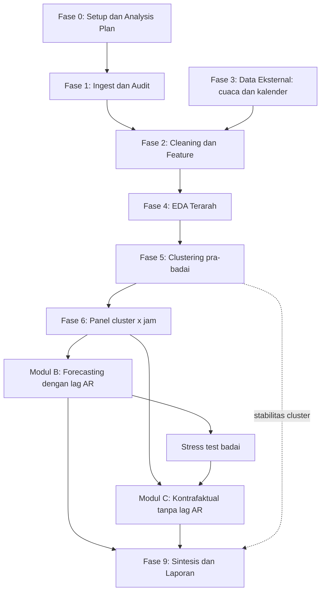
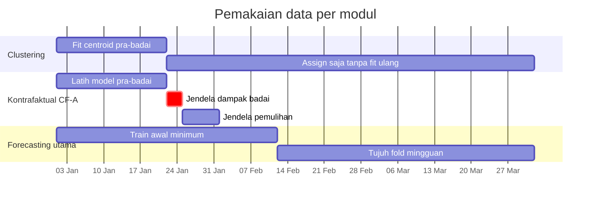
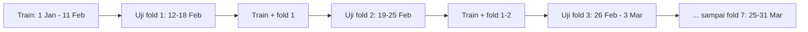
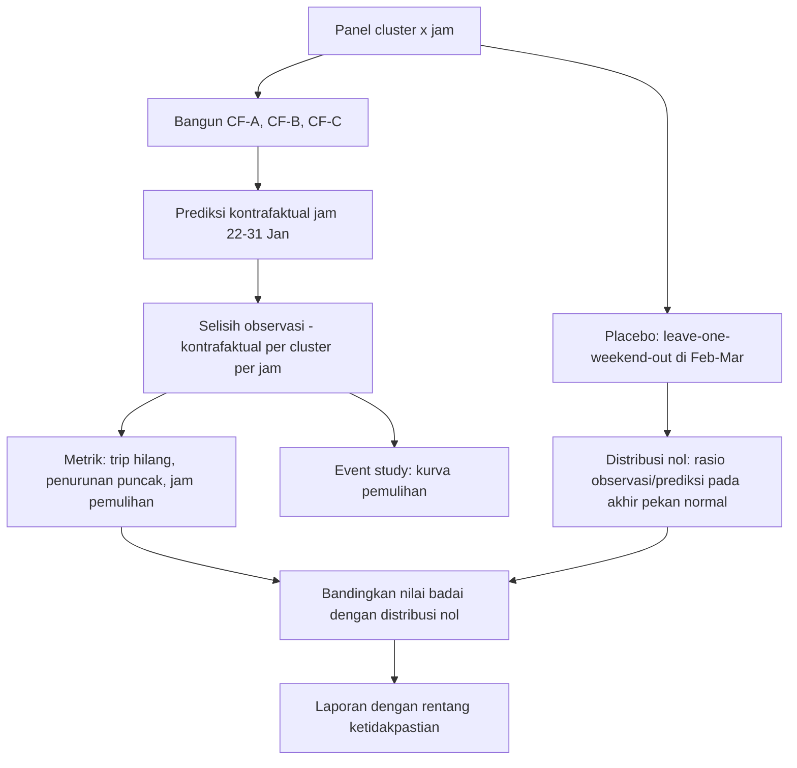

# 🎓 Framework Kerja Detail: **Paket Utama**

### _Demand Clustering → Forecasting per Cluster → Dampak Badai Jonas (NYC Yellow Taxi, Jan-Mar 2016)_

Dokumen ini bisa kamu pakai sebagai **protokol kerja**: tiap fase punya tujuan, langkah, output, dan **gate** (syarat lolos sebelum lanjut).

> 🔧 **Satu revisi dari saran saya sebelumnya.** Dulu saya bilang "fit cluster di data Januari". Sekarang saya perketat jadi **fit di 1-21 Januari (pra-badai)**. Alasannya, cluster yang sama dipakai untuk analisis kausal, sehingga badai tidak boleh ikut memengaruhi definisi cluster.

---

## 1. Rumusan Riset

### 1.1 Pertanyaan dan hipotesis

| Kode    | Pertanyaan                                                                   | Hipotesis yang bisa salah (_falsifiable_)                                               |
| ------- | ---------------------------------------------------------------------------- | --------------------------------------------------------------------------------------- |
| **RQ1** | Apakah zona permintaan (cluster) stabil dari Jan ke Mar?                     | **H1:** pergeseran proporsi pickup per cluster kecil (JSD < 0,02) di luar jendela badai |
| **RQ2** | Seberapa akurat forecast pickup per cluster per jam, dan model mana terbaik? | **H2:** LightGBM mengalahkan _seasonal naive_ (MASE < 1) pada minggu normal             |
| **RQ3** | Berapa trip yang hilang karena Jonas, dan berapa lama pulihnya?              | **H3:** penurunan terdalam di cluster Manhattan, pemulihan terlama di outer borough     |

> Ambang seperti JSD < 0,02 adalah **contoh**. Tetapkan angkamu sendiri **sebelum** melihat hasil, lalu tulis di dokumen _analysis plan_ (Fase 0).

### 1.2 Definisi estimand (apa persisnya yang kamu ukur)

- **Efek badai per jam per cluster:** Δ(c,t) = Y_observasi(c,t) − Ŷ_kontrafaktual(c,t)
- **Trip hilang kumulatif:** Σ Δ pada jendela dampak
- **Penurunan puncak:** persentase di jam terendah
- **Waktu pemulihan:** jam dari titik terendah sampai rasio observasi/kontrafaktual ≥ 0,90 selama 12 jam berturut-turut

> ⚠️ **Catatan konseptual yang sering terlewat:** data ini mencatat **trip yang terjadi** (pertemuan permintaan dan pasokan), bukan permintaan murni. Saat badai, sopir juga tidak keluar dan ada pembatasan perjalanan. Jadi efek yang kamu ukur adalah **"paket badai + kebijakan + pasokan"**, dan kamu tidak bisa memisahkannya. Tulis ini di limitasi.

---

## 2. Arsitektur dan Aturan Anti-Leakage



### 2.1 Siapa memakai data periode mana



### 2.2 Tiga aturan wajib

1. **Modul B (forecasting) boleh memakai lag autoregresif. Modul C (kausal) TIDAK boleh.** Kalau model kontrafaktual memakai `lag_1` atau `lag_168` dari jam badai, lag itu sudah membawa efek badai, dan "dunia tanpa badai" yang kamu hitung ikut terkontaminasi. Model kausal hanya memakai fitur yang **tidak terpengaruh badai**: kalender, profil jam×hari, tren halus, dan suhu.
2. **Semua split berbasis waktu.** Tidak ada random split atau k-fold acak.
3. **Cluster, scaler, dan encoder hanya di-fit pada data latih** dari modul masing-masing.

---

## 3. Struktur Repo dan Reproduksibilitas

```text
nyc-taxi-2016/
├── README.md
├── analysis_plan.md          # dibekukan di Fase 0
├── config.yaml               # tanggal, ambang cleaning, seed, K, dll
├── data/
│   ├── raw/                  # CSV asli (jangan diubah)
│   ├── parquet/              # hasil konversi
│   ├── interim/              # setelah cleaning, ber-cluster
│   └── external/             # cuaca, kalender
├── src/
│   ├── ingest.py
│   ├── clean.py
│   ├── features.py
│   ├── cluster.py
│   ├── panel.py
│   ├── forecast.py
│   ├── causal.py
│   └── metrics.py
├── notebooks/                # 01_audit ... 09_report (tipis, panggil src/)
├── reports/figures/
├── reports/tables/           # attrition, metrik, hasil kausal
└── tests/                    # tes aturan cleaning dan grid waktu
```

Praktik minimum yang saya tuntut: satu `config.yaml` sebagai sumber kebenaran, `seed` tetap, versi library di `requirements.txt`, dan tes otomatis untuk fungsi grid waktu (Fase 6) karena di situlah _bug_ DST muncul.

---

## 4. Fase demi Fase

### 🔹 Fase 0: Setup dan Analysis Plan (Minggu 1)

**Tujuan:** mengunci keputusan sebelum melihat hasil, supaya tidak ada _p-hacking_ versi data science.

**Isi `analysis_plan.md`:**

- RQ, hipotesis, dan ambang (dari Bagian 1)
- Definisi jendela: **pra-badai** 1-21 Jan, **dampak** 22-24 Jan, **pemulihan** 25-31 Jan. Verifikasi tanggal dan jam pembatasan perjalanan dari catatan NWS/NOAA dan pemerintah kota, lalu kutip sumbernya.
- Metrik utama dan sekunder
- Skema validasi dan daftar model yang akan dibandingkan
- Daftar keputusan yang boleh berubah, dan alasan yang sah untuk mengubahnya

**Gate:** dokumen ada, diberi tanggal, dan di-commit sebelum Fase 4.

---

### 🔹 Fase 1: Ingest dan Audit Kualitas (Minggu 1)

**Langkah:**

1. Konversi 3 CSV ke Parquet dengan DuckDB atau Polars, partisi per bulan, dan tipe data eksplisit (datetime, float32 untuk koordinat).
2. Cek skema: nama kolom sama di ketiga file, tidak ada kolom baru atau hilang.
3. Hitung: jumlah baris per file, rentang `pickup_datetime` sebenarnya, persentase null per kolom, dan jumlah duplikat penuh.
4. Cari **timestamp nyasar**, yaitu baris di luar 1 Jan - 31 Mar 2016.

**Output:** `reports/tables/00_audit.csv`

**Gate:** jumlah baris ketiga bulan masuk akal (sekitar 11-12 juta per bulan) dan tidak ada kolom yang 100% null.

---

### 🔹 Fase 2: Cleaning dan Feature Engineering (Minggu 2-3)

**Aturan cleaning:** pakai tabel dari framework sebelumnya (koordinat, jarak, durasi, kecepatan, penumpang, tarif, rate code, konsistensi finansial, timestamp, duplikat).

**Template tabel _attrition_ (wajib):**

| #   | Aturan                         | Baris sebelum | Dibuang | % langkah ini | % kumulatif | Hari dengan buang tertinggi |
| --- | ------------------------------ | ------------- | ------- | ------------- | ----------- | --------------------------- |
| 1   | Pickup di luar rentang tanggal |               |         |               |             |                             |
| 2   | Koordinat di luar NYC          |               |         |               |             |                             |
| 3   | dst.                           |               |         |               |             |                             |

**Cek bias wajib: attrition per hari.** Buat grafik persentase baris yang dibuang per hari. Kalau 22-24 Jan melonjak jauh di atas hari lain, aturan kecepatan atau durasimu sedang menghapus trip badai yang sah (jalan licin membuat kecepatan rendah, bukan error). Longgarkan aturannya, jangan datanya.

**Fitur (tetapkan sekarang, jangan menambah belakangan):**

| Kelompok | Fitur                                                                                          |
| -------- | ---------------------------------------------------------------------------------------------- |
| Kalender | `hour`, `dow`, `is_weekend`, `day_index` (1-91), `is_holiday`, `is_long_weekend`, `is_dst_day` |
| Badai    | `is_impact`, `is_recovery`, `hours_since_storm_start`                                          |
| Cuaca    | `temp_c`, `snowfall`, `snow_depth`, `precip`, `visibility`                                     |
| Spasial  | `cluster_id` (Fase 5), `is_airport`                                                            |

> ❗ Jangan pakai `month` sebagai kategori. Dengan 3 nilai, ia menjadi _proxy_ tren dan badai sekaligus. Pakai `day_index` atau suhu.

**Gate:** attrition total masuk akal (biasanya < 5-10%) dan tidak ada lonjakan di jendela badai.

---

### 🔹 Fase 3: Data Eksternal (Minggu 3, paralel dengan Fase 2)

| Data           | Sumber                                                           | Catatan                                                              |
| -------------- | ---------------------------------------------------------------- | -------------------------------------------------------------------- |
| Cuaca per jam  | NOAA (stasiun Central Park, plus JFK dan LGA untuk area bandara) | Verifikasi ID stasiun dan satuan di dokumentasi NOAA sebelum dipakai |
| Kalender libur | Daftar manual 2016                                               | Tahun Baru, MLK, Presidents' Day, St. Patrick's, Paskah              |
| DST            | 13 Maret 2016                                                    | Jam 02:00 tidak ada di hari itu                                      |

**Keputusan yang harus kamu tulis:** cuaca dipakai sebagai **observasi aktual** atau sebagai **prakiraan**? Pada forecasting 24 jam ke depan, memakai cuaca aktual berarti memberi model "bocoran masa depan" (_oracle_). Tidak dilarang, tapi harus dilabeli jelas di hasil.

**Gate:** tidak ada jam yang kehilangan data cuaca tanpa penjelasan, dan hasil gabungan diperiksa visual (suhu, salju vs tanggal).

---

### 🔹 Fase 4: EDA Terarah (Minggu 3)

EDA di sini bukan jalan-jalan bebas. Targetnya menjawab pertanyaan desain.

| #   | Visual                                                                      | Pertanyaan yang dijawab                              |
| --- | --------------------------------------------------------------------------- | ---------------------------------------------------- |
| 1   | Pickup kota per jam, 91 hari                                                | Apakah badai terlihat jelas? Apakah ada celah data?  |
| 2   | Profil rata-rata per `dow × hour` per bulan                                 | Apakah pola mingguan stabil antar bulan?             |
| 3   | Peta kepadatan pickup (hexbin atau datashader)                              | Berapa terkonsentrasi di Manhattan? Di mana bandara? |
| 4   | Distribusi `trip_distance`, `fare`, `duration` sebelum dan sesudah cleaning | Apakah cleaning masuk akal?                          |
| 5   | Senin libur vs Senin biasa                                                  | Apakah flag libur perlu?                             |
| 6   | Hari DST vs Minggu lain                                                     | Apakah pergeseran jam terlihat?                      |
| 7   | Pickup 22-24 Jan vs Jumat-Minggu lain                                       | Seberapa dalam "lembah" badai?                       |

**Gate:** kamu bisa menjawab dalam satu kalimat tiap pertanyaan di atas dan sudah memutuskan flag kalender mana yang masuk model.

---

### 🔹 Fase 5: Clustering Pra-Badai (Minggu 4) → _Modul A_

#### Keputusan teknis

| Isu           | Keputusan yang disarankan                                                                        | Alasan                                                                                               |
| ------------- | ------------------------------------------------------------------------------------------------ | ---------------------------------------------------------------------------------------------------- |
| Koordinat     | Proyeksikan ke meter (UTM 18N, EPSG:32618), jangan pakai derajat mentah                          | Di lintang NYC, 1° bujur lebih pendek dari 1° lintang. K-means pada derajat mentah mendistorsi jarak |
| Data fit      | **Sampel acak 1-2 juta titik dari 1-21 Jan**                                                     | Cukup representatif, cepat                                                                           |
| Bandara       | **Geofence tetap** untuk JFK, LGA (dan EWR kalau ada), lalu cluster sisanya                      | Pola bandara sangat berbeda dan K-means bisa memecah atau menggabungkannya secara tak menentu        |
| Algoritma     | MiniBatchKMeans sebagai utama                                                                    | Skala besar. HDBSCAN pada sampel atau grid H3 sebagai pembanding opsional                            |
| Pilihan K     | Rentang 15-60, dinilai dengan elbow, silhouette (pada subsampel), dan **interpretabilitas peta** | Silhouette sendirian sering menyesatkan pada data spasial yang padat                                 |
| Sampling bias | Pickup sangat padat di Manhattan, jadi cluster di sana akan kecil dan rapat                      | Itu wajar, tapi cek minimal ukuran cluster                                                           |

```python
import numpy as np, polars as pl
from datetime import datetime
from pyproj import Transformer
from sklearn.cluster import MiniBatchKMeans
from sklearn.metrics import silhouette_score

tf = Transformer.from_crs("EPSG:4326", "EPSG:32618", always_xy=True)

def to_xy(lon, lat):
    x, y = tf.transform(lon, lat)
    return np.column_stack([x, y]) / 1000.0        # satuan km

pre = (clean.filter(pl.col("tpep_pickup_datetime") < datetime(2016, 1, 22))
            .select("pickup_longitude", "pickup_latitude")
            .collect())
fit_df = pre.sample(n=2_000_000, seed=42)
X = to_xy(fit_df["pickup_longitude"].to_numpy(), fit_df["pickup_latitude"].to_numpy())

rng = np.random.default_rng(42)
idx = rng.choice(len(X), 50_000, replace=False)

scores = {}
for k in range(15, 61, 5):
    km = MiniBatchKMeans(k, batch_size=100_000, n_init=5, random_state=42).fit(X)
    scores[k] = (km.inertia_, silhouette_score(X[idx], km.predict(X[idx])))

# setelah K dipilih dan model final di-fit, assign semua baris per potongan
def assign_clusters(df_pl, km, chunk=2_000_000):
    out = []
    for i in range(0, df_pl.height, chunk):
        part = df_pl.slice(i, chunk)
        Xp = to_xy(part["pickup_longitude"].to_numpy(), part["pickup_latitude"].to_numpy())
        out.append(km.predict(Xp))
    return np.concatenate(out)
```

#### Analisis stabilitas (menjawab RQ1)

| Metrik                  | Cara hitung                                                                           | Cara membaca                                                                                       |
| ----------------------- | ------------------------------------------------------------------------------------- | -------------------------------------------------------------------------------------------------- |
| **Pergeseran proporsi** | Jensen-Shannon divergence antara distribusi pickup per cluster di Jan (pra), Feb, Mar | Gunakan **effect size**. Dengan jutaan baris, uji p-value selalu "signifikan" dan tidak informatif |
| **Jarak ke centroid**   | Rata-rata jarak titik ke centroid per bulan                                           | Naik berarti cluster makin tidak cocok                                                             |
| **ARI**                 | Latih ulang K-means per bulan pada sampel bersama, bandingkan label dengan ARI        | Mendekati 1 berarti struktur sama                                                                  |
| **Profil cluster**      | Per cluster: jam puncak, rata-rata tarif, rasio trip ke bandara                       | Beri nama cluster berdasarkan peta, mis. "Midtown", "UES", "JFK"                                   |

**Output:** peta cluster, tabel profil cluster, grafik stabilitas.

**Gate:** tiap cluster punya pickup rata-rata minimal beberapa per jam (cluster yang terlalu sepi digabung atau dievaluasi terpisah), dan namanya masuk akal di peta.

---

### 🔹 Fase 6: Panel Cluster × Jam (Minggu 5)

**Tujuan:** membuat tabel deret waktu **lengkap** (tanpa baris yang hilang diam-diam).

Setelah cluster jadi, agregasi sekitar 34 juta baris menjadi tabel kecil: K cluster × 2.184 jam (sekitar 87 ribu baris untuk K=40). **Seluruh pemodelan setelah ini ringan secara komputasi**. Bagian berat hanya Fase 1-2 dan assign cluster.

**Dua jebakan yang harus ditangani:**

1. **Jam tanpa trip tidak muncul di `group_by`.** Cluster sepi saat badai akan "menghilang" dan membuat model mengira data kosong, padahal nilainya nol. Buat grid lengkap lalu isi 0.
2. **Jam DST (13 Mar 02:00).** Pertahankan baris itu di grid dengan nilai `NaN` (bukan 0 dan bukan dibuang). Dengan begitu `lag_168` tetap sejajar dengan jam dinding minggu sebelumnya. Baris `NaN` dikeluarkan dari pelatihan dan evaluasi. Grid punya 2.184 jam, dan 2.183 di antaranya bernilai valid.

```python
import pandas as pd

hours = pd.date_range("2016-01-01 00:00", "2016-03-31 23:00", freq="h")   # 2.184 jam
grid = pd.MultiIndex.from_product([range(K), hours], names=["cluster", "ts"]).to_frame(index=False)

hourly = (clean_with_cluster
          .with_columns(ts=pl.col("tpep_pickup_datetime").dt.truncate("1h"))
          .group_by("cluster", "ts").agg(pl.len().alias("pickups"))
          .collect().to_pandas())

panel = grid.merge(hourly, on=["cluster", "ts"], how="left")
panel["pickups"] = panel["pickups"].fillna(0)
panel.loc[panel["ts"] == pd.Timestamp("2016-03-13 02:00"), "pickups"] = np.nan   # jam DST tidak ada
panel = panel.sort_values(["cluster", "ts"]).reset_index(drop=True)

# tes wajib: tiap cluster punya tepat 2.184 baris, dan tepat 1 NaN per cluster
assert (panel.groupby("cluster").size() == 2184).all()
assert (panel.groupby("cluster")["pickups"].apply(lambda s: s.isna().sum()) == 1).all()
```

> Catatan: timestamp TLC bersifat _naive_ (waktu lokal tanpa zona), jadi tidak ada konversi zona waktu. Itu justru memudahkan, asalkan grid dibuat seperti di atas.

**Gate:** dua `assert` lolos dan jumlah total pickup di panel sama dengan jumlah baris bersih di Fase 2.

---

### 🔹 Fase 7: Forecasting per Cluster (Minggu 5-6) → _Modul B_

#### 7.1 Desain tugas

| Aspek      | Keputusan                                                                    |
| ---------- | ---------------------------------------------------------------------------- |
| Target     | `pickups(c, t + h)`                                                          |
| Horizon    | **h = 1 jam** (nowcast operasional) dan **h = 24 jam** (perencanaan)         |
| Strategi   | Model langsung (_direct_) per horizon, bukan rekursif                        |
| Aturan lag | Hanya lag dengan **k ≥ h**. Contoh untuk h=24: lag 24, 48, 168               |
| Fitur lain | Rolling mean yang di-`shift` (tanpa bocor), flag kalender, flag badai, cuaca |

#### 7.2 Model yang dibandingkan

| ID      | Model                                                                                                         | Peran                                                  |
| ------- | ------------------------------------------------------------------------------------------------------------- | ------------------------------------------------------ |
| **M0**  | Seasonal naive (nilai jam yang sama 168 jam lalu)                                                             | **Baseline wajib**                                     |
| **M0b** | Rata-rata profil per cluster × dow × hour (dari data latih)                                                   | Baseline kedua, lebih kuat                             |
| **M1**  | ETS atau SARIMA musiman, hanya untuk cluster teratas dan total kota                                           | Pembanding klasik. Mahal kalau untuk semua cluster     |
| **M2**  | **LightGBM global** (satu model untuk semua cluster, `cluster` sebagai kategori) dengan `objective="poisson"` | Kandidat utama                                         |
| **M3**  | GRU kecil (opsional)                                                                                          | Hanya kalau M2 sudah matang. Seri pendek rawan overfit |

> Data berupa **hitungan** dengan banyak nol di cluster sepi, jadi objective Poisson lebih tepat daripada MSE.

#### 7.3 Validasi _rolling origin_



Tujuh fold × 7 hari = 49 hari (12 Feb - 31 Mar). Setiap fold memuat semua hari dalam seminggu. Fold 1 memuat Presidents' Day, fold 5 memuat DST, dan fold 7 memuat Paskah. Itu bagus untuk analisis error per kejadian.

```python
import lightgbm as lgb

H = 24
lags = [l for l in (1, 2, 3, 24, 48, 168) if l >= H]
g = panel.groupby("cluster")["pickups"]
for L in lags:
    panel[f"lag_{L}"] = g.shift(L)
panel["roll24"] = g.transform(lambda s: s.shift(H).rolling(24, min_periods=12).mean())
panel["y"] = g.shift(-H)                        # target = pickups pada t+H
panel["cluster"] = panel["cluster"].astype("category")

feats = [f"lag_{L}" for L in lags] + ["roll24", "cluster", "hour", "dow", "is_holiday",
                                      "is_impact", "is_recovery", "temp_c", "snowfall"]
folds = pd.date_range("2016-02-12", periods=7, freq="7D")
results = []

for start in folds:
    end = start + pd.Timedelta(days=7)
    tr = panel[(panel["ts"] < start) & panel["y"].notna()]
    te = panel[(panel["ts"] >= start) & (panel["ts"] < end) & panel["y"].notna()]
    m = lgb.LGBMRegressor(objective="poisson", n_estimators=600, learning_rate=0.05,
                          num_leaves=63, subsample=0.8, subsample_freq=1,
                          colsample_bytree=0.8, random_state=42, verbose=-1)
    m.fit(tr[feats], tr["y"], categorical_feature=["cluster"])
    te = te.assign(pred=m.predict(te[feats]), fold=start)
    results.append(te[["cluster", "ts", "y", "pred", "fold"]])

res = pd.concat(results)
```

Catatan kode: pastikan `y` dihitung dari `pickups` **sesudah** grid lengkap (Fase 6), dan baris dengan `NaN` (jam DST) otomatis keluar lewat `notna()`.

#### 7.4 Metrik

| Metrik                                               | Alasan                                       |
| ---------------------------------------------------- | -------------------------------------------- |
| **WAPE** = Σ\|error\| / Σ aktual                     | Stabil walau ada nilai nol, mudah dijelaskan |
| **MASE** (skala dengan seasonal naive di data latih) | Di bawah 1 berarti mengalahkan baseline      |
| **MAE / RMSE**                                       | Skala asli (trip per jam)                    |
| **Poisson deviance**                                 | Cocok untuk data hitungan                    |
| ~~sMAPE / MAPE~~                                     | Hindari: meledak di nilai nol                |

Laporkan semua metrik per: **fold, cluster, jam-dalam-sehari, hari kerja vs akhir pekan, hari libur vs normal**. Bandingkan model dengan **bootstrap berblok per hari** (bukan bootstrap baris, karena error berautokorelasi).

#### 7.5 Ablation dan interpretasi

| Eksperimen                      | Pertanyaan                                  |
| ------------------------------- | ------------------------------------------- |
| Tanpa cuaca vs dengan cuaca     | Seberapa besar nilai tambah cuaca?          |
| Tanpa flag badai vs dengan flag | Apakah model belajar badai?                 |
| Latih dengan vs tanpa 22-31 Jan | Pilihan mana lebih robust? Tulis pilihanmu. |
| SHAP pada LightGBM (sampel)     | Fitur apa yang dipakai? Sesuai intuisi?     |

#### 7.6 Stress test badai

Latih pada 1-21 Jan, lalu uji pada 22-31 Jan. **Error besar di sini adalah temuan, bukan kegagalan.** Hasil ini menjadi jembatan ke Modul C.

**Gate:**

- M2 mengalahkan M0 dan M0b pada minggu normal (MASE < 1). Kalau tidak, **berhenti dan debug** dulu (kemungkinan leakage terbalik atau fitur salah).
- Tidak ada fitur yang memakai informasi dari masa depan (cek manual dengan menggeser satu fitur dan melihat apakah skor turun tajam secara mencurigakan).

---

### 🔹 Fase 8: Analisis Dampak Badai (Minggu 7) → _Modul C_

Ini inti kontribusi proyekmu. Tujuannya menjawab: **"andai badai tidak terjadi, berapa trip yang akan ada?"**

#### 8.1 Desain kontrafaktual (tiga versi sebagai rentang sensitivitas)

| Versi                       | Data latih                                   | Fitur                                                  | Kelebihan                                   | Kelemahan                                                                                 |
| --------------------------- | -------------------------------------------- | ------------------------------------------------------ | ------------------------------------------- | ----------------------------------------------------------------------------------------- |
| **CF-A: pra-badai saja**    | 1-21 Jan                                     | Kalender, profil cluster×dow×hour, suhu. **Tanpa lag** | Urutan waktu bersih                         | Hanya 3 minggu. Tahun Baru dan MLK Day mengontaminasi sebagian Jumat-Minggu               |
| **CF-B: _leave-storm-out_** | Semua hari **kecuali** 22-31 Jan             | Sama, ditambah `day_index` halus dan suhu              | Data jauh lebih banyak, profil lebih stabil | Memakai data pasca-badai (interpolasi, bukan ekstrapolasi). Asumsi struktur Feb-Mar mirip |
| **CF-C: hari pembanding**   | Jumat, Sabtu, Minggu non-badai dan non-libur | Rata-rata per cluster×jam                              | Sederhana, mudah dijelaskan                 | Sedikit hari, rentan _noise_                                                              |

**Laporkan ketiganya.** Kalau hasilnya konsisten, klaimmu kuat. Kalau berbeda jauh, itu informasi tentang ketidakpastian, dan itu jujur.

> Kenapa tanpa lag? Ingat Aturan #1 di Bagian 2.2.



#### 8.2 Kode inti: efek dan waktu pemulihan

```python
def hours_to_recovery(ts, y, yhat, trough_ts, thr=0.90, win=6, stay=12):
    """ts: DatetimeIndex per jam (seri kota atau cluster besar).
    Pulih = rasio observasi/kontrafaktual (jendela win jam) >= thr selama stay jam berturut-turut."""
    s = pd.DataFrame({"y": y, "yhat": yhat}, index=ts)
    r = s["y"].rolling(win).sum() / s["yhat"].rolling(win).sum()
    ok = (r >= thr).astype(int).rolling(stay).sum().eq(stay)
    after = ok[ok.index > trough_ts]
    if not after.any():
        return np.nan
    t_end = after[after].index[0]
    t_start = t_end - pd.Timedelta(hours=stay - 1)
    return (t_start - trough_ts) / pd.Timedelta(hours=1)

city = res_cf.groupby("ts")[["y", "yhat"]].sum()
lost_trips = (city["yhat"] - city["y"]).loc["2016-01-22":"2016-01-24"].sum()
trough_ts = (city["y"] / city["yhat"]).loc["2016-01-22":"2016-01-27"].idxmin()
rec_hours = hours_to_recovery(city.index, city["y"], city["yhat"], trough_ts)
```

Untuk cluster kecil, rasio observasi/prediksi tidak stabil. Hitung pemulihan di tingkat **kota** dan **cluster besar**, sisanya digabung per borough atau per tipe (Manhattan, bandara, outer borough).

#### 8.3 Placebo dan ketidakpastian (membedakan "efek" dari "noise")

Pertanyaan kritis penguji: _"Berapa besar selisih yang bisa muncul hanya karena model kontrafaktualmu tidak sempurna?"_

**Prosedur _leave-one-weekend-out_:**

1. Untuk tiap akhir pekan Jumat-Minggu normal di Feb-Mar, keluarkan akhir pekan itu dari data latih.
2. Latih ulang model kontrafaktual (versi CF-B).
3. Hitung rasio Σ observasi / Σ prediksi pada jendela 72 jam itu.
4. Kumpulkan rasio-rasio itu sebagai **distribusi nol**.
5. Bandingkan rasio badai dengan distribusi nol. Kalau jauh di luar rentangnya, efeknya nyata.

Ini lebih jujur daripada selang kepercayaan model, karena mengukur kesalahan metodenya sendiri.

#### 8.4 Regresi pelengkap (opsional untuk level lanjut)

Poisson pseudo-maximum likelihood dengan _fixed effect_:

> log E[Y(c,t)] = α(c) + β(hour × dow) + γ·holiday + δ·temp + Σ θ_k·StormPhase_k(t) + ε

- `StormPhase_k` = dummy per fase (sebelum, dampak, pemulihan, sesudah).
- Galat baku: **cluster per hari** atau HAC (Newey-West), karena autokorelasi kuat.
- Event study: dummy per blok 6 jam di sekitar badai, lalu plot koefisien beserta selang kepercayaannya.

#### 8.5 Heterogenitas

| Pembagian                                                  | Pertanyaan                                          |
| ---------------------------------------------------------- | --------------------------------------------------- |
| Per cluster / per tipe (Manhattan, bandara, outer borough) | Di mana penurunan terdalam? Di mana pulih tercepat? |
| Per jenis trip (jarak pendek vs panjang)                   | Apakah trip pendek hilang lebih dulu?               |
| Per metode bayar                                           | Apakah komposisi kartu vs cash bergeser saat badai? |
| Tip (kartu kredit saja)                                    | Apakah `tip_pct` turun/naik?                        |

**Gate:**

- Hasil dilaporkan sebagai **rentang** dari tiga desain, bukan satu angka.
- Ada distribusi nol dari placebo.
- Klaim di laporan tidak melebihi bukti (lihat Bagian 8.6).

#### 8.6 Batas klaim

| ✅ Boleh                                                                                                     | ❌ Jangan                                                       |
| ------------------------------------------------------------------------------------------------------------ | --------------------------------------------------------------- |
| "Pada jendela 22-24 Jan, volume trip berasosiasi dengan penurunan X% (rentang a-b%) dibanding kontrafaktual" | "Badai salju menurunkan permintaan taksi X%" sebagai hukum umum |
| "Efek berbeda antar tipe cluster"                                                                            | "Penyebabnya adalah ..." tanpa bukti mekanisme                  |
| "Pemulihan 90% dalam sekitar N jam setelah titik terendah"                                                   | Menyamakan trip terobservasi dengan permintaan murni            |

---

### 🔹 Fase 9: Sintesis dan Laporan (Minggu 8)

**Satu tabel integratif** menyatukan ketiga modul:

| Cluster | Stabilitas (JSD) | Forecastability (WAPE normal) | Penurunan badai (%) | Jam pemulihan | Catatan |
| ------- | ---------------- | ----------------------------- | ------------------- | ------------- | ------- |
| Midtown |                  |                               |                     |               |         |
| JFK     |                  |                               |                     |               |         |
| ...     |                  |                               |                     |               |         |

Pertanyaan sintesis yang menarik:

- Apakah cluster yang **sulit diprediksi** juga yang **paling sensitif terhadap badai**?
- Apakah cluster yang stabil secara spasial juga stabil secara temporal?
- Apa implikasi operasional? Misalnya, untuk cluster dengan pemulihan lambat, aturan "tunggu di cluster Y" perlu direvisi saat cuaca ekstrem.

---

## 5. Daftar Keputusan Desain (Decision Log)

Isi tabel ini dan simpan di repo. Penguji suka sekali dokumen seperti ini.

| #   | Keputusan                     | Default saya              | Alasan                          | Pilihanmu |
| --- | ----------------------------- | ------------------------- | ------------------------------- | --------- |
| 1   | Jendela dampak dan pemulihan  | 22-24 Jan dan 25-31 Jan   | Verifikasi dengan data NWS      |           |
| 2   | Jumlah cluster K              | 30-50                     | Interpretabilitas peta + metrik |           |
| 3   | Bandara sebagai cluster tetap | Ya                        | Pola unik                       |           |
| 4   | Horizon forecasting           | 1 jam dan 24 jam          | Operasional vs perencanaan      |           |
| 5   | Cuaca aktual atau prakiraan   | Aktual, dilabeli _oracle_ | Tidak ada data prakiraan        |           |
| 6   | Badai di data latih model B   | Pakai flag, uji ablation  | Transparan                      |           |
| 7   | Metrik utama                  | WAPE dan MASE             | Stabil terhadap nol             |           |
| 8   | Versi kontrafaktual utama     | Laporkan CF-A, B, C       | Sensitivitas                    |           |

---

## 6. Risiko dan Mitigasi

| Risiko                                 | Dampak                                          | Mitigasi                                            |
| -------------------------------------- | ----------------------------------------------- | --------------------------------------------------- |
| Kontaminasi lag di model kontrafaktual | Efek badai terlihat lebih kecil dari seharusnya | Aturan #1 (tanpa lag di Modul C)                    |
| Cleaning menghapus trip badai          | Efek badai bias                                 | Cek attrition per hari                              |
| Jam kosong tidak di-grid               | Model mengira data hilang, padahal 0            | Fase 6 + `assert`                                   |
| Bug DST                                | Lag salah satu jam selama seminggu              | Pertahankan baris `NaN`, bukan hapus                |
| Overfit pada seri pendek               | Skor validasi menipu                            | Baseline kuat, model sederhana dulu, rolling origin |
| Clustering memakai data badai          | Cluster mengandung efek yang mau diukur         | Fit hanya pada 1-21 Jan                             |
| Komputasi (RAM)                        | Pipeline berhenti di tengah                     | Parquet + Polars lazy, sampel untuk fit cluster     |
| Klaim berlebihan                       | Dikritik penguji                                | Bagian 8.6 + bagian limitasi di laporan             |
| Terlalu banyak model                   | Fokus buyar                                     | Maksimal 4 model, ablation kecil dan terarah        |

---

## 7. Jadwal 8 Minggu (Ringkas)

| Minggu | Fase           | Deliverable                         | Gate                                |
| ------ | -------------- | ----------------------------------- | ----------------------------------- |
| 1      | 0 dan 1        | `analysis_plan.md`, tabel audit     | Dokumen dibekukan, baris masuk akal |
| 2      | 2              | Tabel attrition, data bersih        | Tidak ada lonjakan buangan di badai |
| 3      | 2, 3, 4        | Fitur, cuaca, 7 visual EDA          | Flag kalender diputuskan            |
| 4      | 5              | Cluster + peta + stabilitas         | Cluster bermakna di peta            |
| 5      | 6 dan 7 (awal) | Panel, baseline M0/M0b              | `assert` grid lolos                 |
| 6      | 7              | M1-M2, rolling origin, SHAP         | M2 mengalahkan baseline             |
| 7      | 8              | CF-A/B/C, placebo, event study      | Rentang + distribusi nol            |
| 8      | 9              | Laporan, notebook final, presentasi | Checklist Bagian 9                  |

> Kalau waktumu lebih pendek, kurangi: **M3 (GRU), regresi PPML, dan HDBSCAN** adalah yang paling aman dibuang. Jangan buang placebo atau cek attrition per hari.

---

## 8. Kerangka Isi Laporan

| Bab            | Isi                                                            | Halaman (kira-kira) |
| -------------- | -------------------------------------------------------------- | ------------------- |
| 1. Pendahuluan | Konteks, RQ, hipotesis, kontribusi                             | 2-3                 |
| 2. Data        | Deskripsi, audit, attrition, data eksternal                    | 3-4                 |
| 3. Metodologi  | Clustering, forecasting, kontrafaktual, validasi, anti-leakage | 5-6                 |
| 4. Hasil A     | Cluster dan stabilitas                                         | 3-4                 |
| 5. Hasil B     | Perbandingan model, ablation, error analysis                   | 4-5                 |
| 6. Hasil C     | Efek badai, rentang tiga desain, placebo, heterogenitas        | 4-5                 |
| 7. Diskusi     | Sintesis, implikasi operasional                                | 2-3                 |
| 8. Limitasi    | Satu badai, 13 minggu, trip vs permintaan, cash tip, dll       | 1-2                 |
| 9. Kesimpulan  | Jawaban RQ1-RQ3 dan saran lanjutan                             | 1                   |

---

## 9. Checklist Akhir (Definition of Done)

- [ ] `analysis_plan.md` ada, bertanggal, dan tidak diubah diam-diam
- [ ] Tabel attrition lengkap, **plus** grafik attrition per hari
- [ ] Cluster di-fit **hanya** pada 1-21 Jan, dan stabilitasnya dilaporkan
- [ ] Panel punya grid lengkap, nol terisi, dan jam DST ditandai `NaN`
- [ ] Ada baseline M0 dan M0b, dan model utama dibandingkan dengan keduanya
- [ ] Validasi _rolling origin_, tanpa split acak
- [ ] Model kontrafaktual **tanpa lag AR**
- [ ] Efek badai dilaporkan sebagai **rentang** dari beberapa desain
- [ ] Ada placebo atau distribusi nol
- [ ] Keterbatasan ditulis jujur, termasuk "trip terobservasi ≠ permintaan"
- [ ] Repo bisa dijalankan ulang dari `config.yaml` dan seed tetap

---

### ✅ Catatan penutup dari saya

Pegang satu ide: **Modul B mengukur seberapa baik kamu bisa memprediksi dunia yang normal, dan Modul C memakai ketidakmampuan prediksi itu secara sengaja untuk mengukur dunia yang tidak normal.** Kalau kamu bisa menjelaskan hubungan ini dengan jelas di sidang, proyekmu akan terlihat sebagai satu cerita utuh, bukan tiga tugas yang ditempel.

Satu pertanyaan penentu sebelum kamu mulai: **laptop atau komputer yang akan kamu pakai punya RAM berapa?** Dari situ saya bisa tentukan apakah Fase 1-2 aman dengan Polars di satu mesin atau perlu strategi sampel dan pemrosesan per bulan. Setelah itu saya bisa buatkan skeleton notebook per fase.
